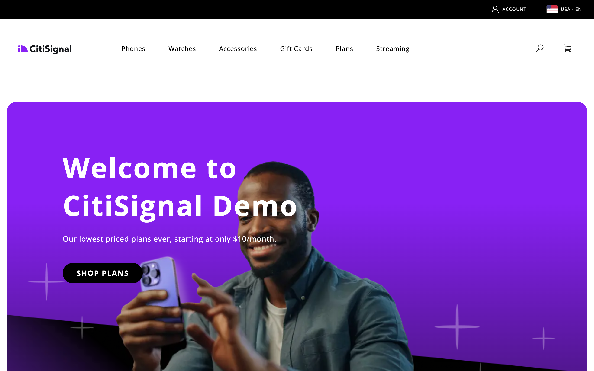
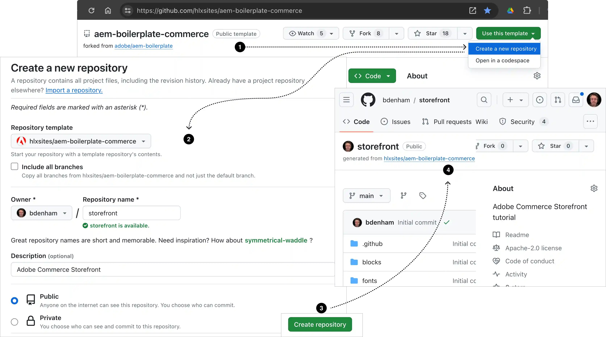
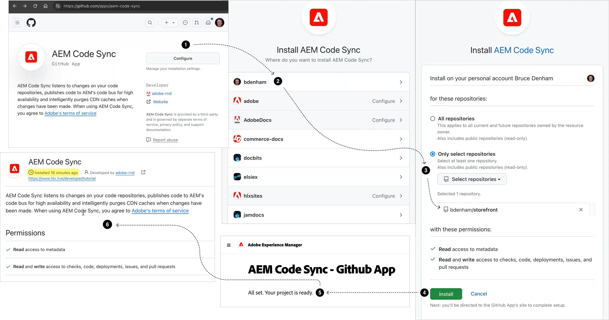
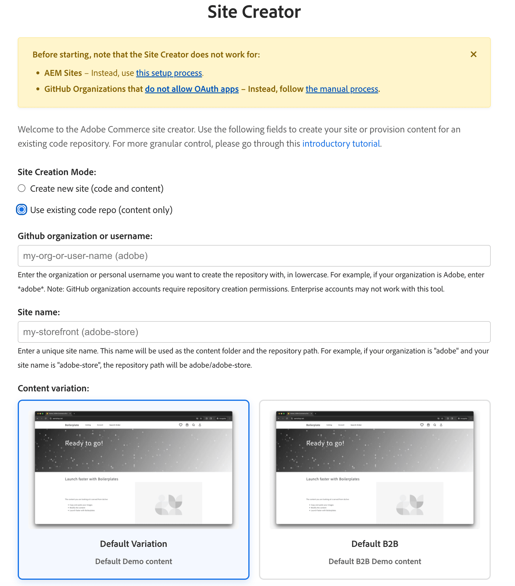

import { Tabs, TabItem, Steps } from '@astrojs/starlight/components';
import Tasks from '@components/Tasks.astro';
import Task from '@components/Task.astro';
import Callouts from '@components/Callouts.astro';
import Diagram from '@components/Diagram.astro';
import Aside from '@components/Aside.astro';
import Link from '@components/Link.astro';
import Term from '@components/Term.astro';
import TableWrapper from '@components/TableWrapper.astro';
import SecurityNotice from 'src/content/fragments/security-notice.mdx';

Create a new storefront project with its own GitHub repository, Commerce connection, and starter content in Document Authoring on DA.live. Connect these parts so the project is ready for local development.

If your team already has a configured storefront, [run it locally](/get-started/run-locally/) instead of repeating project setup. Use this procedure only to create or complete a storefront environment.

Before creating the project, confirm your backend type and access to its required services using the [backend requirements table](#which-backend-do-you-have). If Commerce data or services are missing, return to the backend checklist before treating it as a repository problem.

[Prerequisites](/get-started/before-you-start/) lists the accounts, permissions, and tools needed for project creation. For local tooling, content preview URLs, and verification, use [Run your storefront locally](/get-started/run-locally/).

You can return later for optional steps such as <Term>Sidekick</Term> and <Term>Experience Workspace</Term>.

## Site Creator or this walkthrough

Use <Link href="https://da.live/app/adobe-commerce/storefront-tools/tools/site-creator/site-creator" text="Site Creator" /> in <Link href="https://da.live/" text="DA.live" /> when your organization allows it. Its new-site flow creates the repository, adds starter content, and fills most storefront configuration.

For more control over repository creation and configuration, follow the manual tasks below. That path still uses Site Creator to provision starter content for an existing repository. It is not a Site Creator-free setup.

### Which should you use?

Use Site Creator first when you want the fastest path and your organization allows it.

Follow the manual tasks when you need to see how the pieces connect or use your team's repository process. Typical cases include the following:

- You are new to the stack and want to see what each step does before you run it in a live project.
- Your organization limits who can create repositories or install GitHub Apps, so you follow an approved process step by step.
- You are fixing a store that is only partly configured, or you must run steps in a fixed order for automation.
- You already have a repository and you use Site Creator only to connect content. You may still run some tasks by hand, and the sections below explain what each part is for.

If your organization does not allow Site Creator at all, ask the project owner for an approved content-provisioning process before starting. The manual repository tasks do not provide an alternative content-provisioning tool.

## Big picture

This how-to uses <Term>Edge Delivery Services</Term> (EDS) to host the storefront, the Commerce boilerplate for code, and Document Authoring (DA.live) for page content. You create a new EDS storefront from the <Link href="https://github.com/hlxsites/aem-boilerplate-commerce" text="Commerce boilerplate template" />. After you connect your own backend, the same repo holds local preview, demo content, and a path to production.

Complete the repository, code connection, Commerce configuration, and content setup first. Then continue to local development. Authoring tools can wait; review access controls before sharing the site.

<Diagram type="mermaid" code={`
flowchart LR
    repo["Create or reuse a storefront repository"]
    sync["Connect Code Sync"]
    config["Connect Commerce configuration"]
    content["Add or confirm page content"]
    repo --> sync --> config --> content
`} caption="The four project-creation milestones. Continue to local preview after these connections are in place." />

<Callouts columnCount={1}>

1. Create the site repository: Generate a storefront repository from the <Link href="https://github.com/hlxsites/aem-boilerplate-commerce" text="boilerplate template" />, or reuse your team's existing storefront repository.
1. Add the Code Sync app: Connect Edge Delivery Services to the repository so it can deliver the storefront code.
1. Link the repository to Commerce data: Save the approved connection values in shared site configuration or a local or feature-branch override, as appropriate for the project.
1. Add content: Use the team's existing content source or copy starter content with Site Creator's existing-code-repository option.
1. Experience Workspace: Edit content in context on the rendered page.
1. Sidekick: Preview, publish, and open source documents from the live site.
1. Set up a local environment: Clone the repo onto your computer. Run your storefront and confirm your data: Install dependencies, start the local server, and check that your own Commerce data appears.
1. Secure the storefront: Tighten access to content, the repository, and the site before production or a wide audience.

</Callouts>

<Aside type="note" title="Document Authoring content source">
This walkthrough uses <Term>Document Authoring</Term> on <Link href="https://da.live/" text="DA.live" />, the default for new EDS storefronts. For AEM Sites content (for example, Commerce drop-ins on an existing AEM as a Cloud Service site), content setup differs. See the <Link href="https://github.com/adobe-rnd/aem-boilerplate-xcom" text="XCOM boilerplate" /> and <Link href="https://experienceleague.adobe.com/en/docs/experience-manager-cloud-service/content/edge-delivery/overview" text="Edge Delivery Services with AEM Sites" />.
</Aside>

## Which backend do you have?

Confirm which platform handles cart, checkout, and accounts for your project. Using the included drop-ins requires an active Adobe Commerce as a Cloud Service or Adobe Commerce Optimizer license. See [Licensing requirements](/licensing/) if you are unsure.

<TableWrapper>

| Your project's backend | What to confirm before continuing |
| --- | --- |
| [Adobe Commerce as a Cloud Service](/get-started/backends/#adobe-commerce-as-a-cloud-service) | Confirm access to the intended environment. Adobe manages its platform packages; your team configures the storefront connection. |
| [Adobe Commerce on Cloud or on-premises with Adobe Commerce Optimizer](/get-started/backends/#commerce-platform-as-a-service-paas) | Complete [PaaS: required packages and services](/get-started/backends/#paas-required-packages-and-services) on the existing Commerce deployment. Optimizer catalog services do not replace those requirements. |
| [Adobe Commerce Optimizer with a third-party platform](/get-started/backends/#adobe-commerce-optimizer) | Confirm the catalog connection and who owns the project-specific cart, checkout, and account integration. Connecting the catalog does not complete that integration. |

</TableWrapper>

Use [Backend options](/get-started/backends/) for the full requirements. If your team already selected and configured a backend, confirm that setup rather than choosing a different platform for this procedure.

The steps below apply to every backend unless a note says otherwise. Backend-specific detail starts at [Link your repository to Commerce data](#link-your-repository-to-commerce-data).

Use a known product to confirm catalog synchronization. For Adobe Commerce Optimizer, check <Link href="https://experienceleague.adobe.com/en/docs/commerce/optimizer/setup/data-sync" text="Data Sync" />. If the project uses Adobe Commerce Optimizer Connector, also review <Link href="https://experienceleague.adobe.com/en/docs/commerce/aco-optimizer-connector/troubleshooting/troubleshooting-scenarios" text="Connector troubleshooting" />. For Catalog Service or Live Search configurations, use [Data export validation](/setup/discovery/data-export-validation/).

If this Commerce project already has a working Edge Delivery storefront, reuse its repository and content source. Continue with [Run your storefront locally](/get-started/run-locally/) rather than importing or recreating the project.

## Example site

To see what you can build from the same boilerplate, explore the CitiSignal demo storefront at <Link href="https://main--citisignal-one--adobedevxsc.aem.live/" text="main--citisignal-one--adobedevxsc.aem.live" />.

## Manual repository setup

Create the repository from the <Link href="https://github.com/hlxsites/aem-boilerplate-commerce" text="Commerce boilerplate template" /> and install the <Link href="https://github.com/apps/aem-code-sync" text="AEM Code Sync app" /> through your approved GitHub process. Then use Site Creator's **Use existing code repo (content only)** option in [Add content](#add-content).

If your team already has a configured storefront with working content, reuse it and continue with [Run your storefront locally](/get-started/run-locally/).

## Step-by-step

Set up the repository and Code Sync first, then connect Commerce data, add Document Authoring content, and prepare for local development and security. Follow this order unless a note tells you to wait or skip. If a label or step is unfamiliar, use [Architecture](/get-started/architecture/) or [Prerequisites](/get-started/before-you-start/) for background.

<Tasks>

<Task>

### Create the site repository

This task requires a GitHub account with access to the organization or account where you want to create the new repository. All three backends use the same boilerplate template.

<Tabs>

<TabItem label="Personal GitHub account">

Create the repo under your personal account by choosing your username as the Owner. You'll install the Code Sync app on that repository in the next step.

</TabItem>

<TabItem label="GitHub Enterprise (organization)">

Create the repo under your organization by choosing the organization as the Owner. Because installing the Code Sync app may require admin approval, confirm that you have permission to create repositories and install GitHub Apps in the organization.

<Aside type="note" title="Trouble with organization access?">
If you have trouble with your organization access, you can create your repo from a personal account first, then migrate that repo to a <Link href="https://www.aem.live/docs/repoless" text="repoless" /> Edge Delivery Services site after you learn more about EDS and repoless.
</Aside>

</TabItem>

</Tabs>

<Diagram caption="Create your storefront repo.">
  
</Diagram>

<Aside type="note" title="Sign in to GitHub first">
  Sign in to your GitHub account before you open the repository's **Use this template** control. If you are not signed in, that control does not appear.
</Aside>

<Steps>

1. Navigate to <Link href="https://github.com/hlxsites/aem-boilerplate-commerce" text="aem-boilerplate-commerce" />.

1. Select the **Use this template** button.

1. Select **Create a new repository** when GitHub shows that option. The repository creation form opens.

1. Complete the form with the following details:

   - Repository template: `hlxsites/aem-boilerplate-commerce` (default).
   - Include all branches: Do not include all branches (default).
   - Owner: Your organization or account (required).
   - Repository name: A unique name for your new repo (required). GitHub allows letters, numbers, hyphens, and underscores. For Commerce on Edge Delivery Services, use lowercase letters, numbers, and hyphens only so preview and live URLs match the usual `main--your-repo--your-org` pattern.
   - Description: A brief description of your repo (optional).
   - Public or Private: We recommend public (default).

1. Select the Create repository button and watch GitHub create your new storefront repo.

1. After a few seconds, you should be redirected to the home page of your new repo.

</Steps>

<Aside type="tip" title="Managed backends">
Adobe Commerce as a Cloud Service and Adobe Commerce Optimizer use the same repo creation steps above. The only difference is in the next step when you configure the storefront to point to your managed environment.
</Aside>

</Task>

<Task>

### Add the Code Sync app

Install the Code Sync app on your repository (it cannot be installed globally on a user or org). It redeploys your storefront site whenever you push or merge changes to the `main` branch. That behavior is the same for every backend in the table above.

<Diagram caption="Add AEM Code Sync to your repository.">
  
</Diagram>

<Aside type="note" title="Slightly different UIs">
  A gray background on an organization or account indicates that at least one repository within it
  has the Code Sync app installed. In such cases, you are redirected to the Code Sync configuration page for that org or account, where you choose which repositories have the app. There are no differences in the steps, but the UI differs slightly from the one shown in the diagram (Install versus Save buttons), which shows the Code Sync page when installing on a repository for the first time.
</Aside>

<Tabs>

<TabItem label="Personal GitHub account">

Select your username when choosing where to install. You will see your personal repositories in the selector.

</TabItem>

<TabItem label="GitHub Enterprise (organization)">

Select your organization. You may need admin approval to install the Code Sync app on repositories. If your organization uses SAML SSO, you may need to authorize the app for SAML SSO access.

</TabItem>

</Tabs>

<Steps>

1. Navigate to the <Link href="https://github.com/apps/aem-code-sync" text="AEM Code Sync app" />.

1. Select the **Configure** button (top right). GitHub opens the page where you choose which repository receives the app.

1. Select the organization or account that owns the repo you just created.

1. In the form, choose **Only select repositories**.

1. Open the **Select repositories** selector and choose your repo from the list.

1. Select **Install** (or **Save**, as noted above) to install Code Sync on your repository.

1. You should see a success screen if the installation completed without errors. Your repo is now connected to the Edge Delivery Services code bus.

1. (_Optional_) If you return to the <Link href="https://github.com/apps/aem-code-sync/installations/select_target" text="account selection page" />, your repo's organization or account will now be gray with **Configure** added. Select your organization or account again to access the Code Sync configuration page, where you can see which repositories have Code Sync installed and add it to more repositories.

</Steps>

</Task>

<Task>

### Link your repository to Commerce data

Follow [Connect your storefront to Commerce](/setup/configuration/commerce-configuration/#connect-your-storefront-to-commerce) to gather connection values, generate the configuration, and save it in the right source for your project. That task covers both shared site configuration and local or feature-branch overrides.

If Site Creator already configured the connection, review the existing settings rather than generating a replacement. After content is available and the preview is running, use [Confirm the loaded configuration](/setup/configuration/commerce-configuration/#confirm-the-loaded-configuration) to check the settings the browser actually uses.

</Task>

<Task>

### Add content

With the repository connected, create and initialize its content in the Document Authoring environment, using the same steps for every backend.

<Aside type="note" title="Use an empty destination for starter content">
Site Creator rejects a destination that already contains content. If your team has working Document Authoring content, reuse that content source and skip the starter-content copy.
</Aside>

<Steps>

1. Open the <Link href="https://da.live/app/adobe-commerce/storefront-tools/tools/site-creator/site-creator" text="Site Creator app" /> in DA.live.

1. Select **Use existing code repo (content only)**.

1. Copy the GitHub owner and site values into the input fields.

1. Select **Create site**.

1. Follow the prompts until Site Creator finishes copying starter content into your content folder.

1. If prerequisites were incomplete, you may need to preview or publish the content manually.

</Steps>

<Diagram caption="Initialize your storefront content">
  
</Diagram>

</Task>

</Tasks>

## Confirm project creation

Before continuing, confirm that:

- The storefront repository exists in the intended GitHub organization.
- Code Sync has access to that repository.
- The approved Commerce connection values are saved.
- The intended content source and its preview URL are available.

Keep the repository URL, content preview URL, and selected Commerce environment together for local setup. These milestones confirm that the project has been created, not that every shopping feature has passed testing.

## What's next

Continue with [Run your storefront locally](/get-started/run-locally/). It covers cloning or reusing the repository, installing dependencies, preparing drop-in assets, and starting the preview.

For a new or changed Commerce connection, then complete [Verify your storefront setup](/get-started/verify-setup/) for the shopping features in your project's agreed scope.

## Optional authoring tools

These tools support content editing. They are not prerequisites for the local code preview.

### Use Experience Workspace for content editing

Experience Workspace lets authors edit content directly on the rendered page as well as in the document editor. Because it's off by default, you may need to update your storefront's code to enable it. Follow [Using Experience Workspace](/merchants/quick-start/experience-workspace/) for setup, then share that topic with your authors for day-to-day use.

### Use Sidekick for content editing

Install the Sidekick browser extension from the Chrome Web Store, or follow the Edge installation steps in <Link href="https://www.aem.live/docs/sidekick" text="Using AEM Sidekick" />. Once installed, Sidekick detects your project's preview and live URLs automatically. If it doesn't recognize your project, add it manually from Sidekick's menu. For the access and setup you need first, see [Prerequisites](/get-started/before-you-start/#sidekick-browser-extension).

## Secure your storefront before sharing

Before sharing the site outside your team or preparing for production, configure access to content, the repository, and the site. Follow [Security and access](/setup/launch/launch-checklist/#security-and-access) in the Launch checklist.

<SecurityNotice />

## More help on this topic

- [Storefront configuration](/setup/configuration/commerce-configuration/): Look up connection settings and configuration sources.
- [Drop-ins overview](/dropins/all/introduction/) and [Extending drop-ins](/dropins/all/extending/): Understand and customize the included shopping features.
- [Launch checklist](/setup/launch/launch-checklist/): Check security, performance, and other requirements before production.
