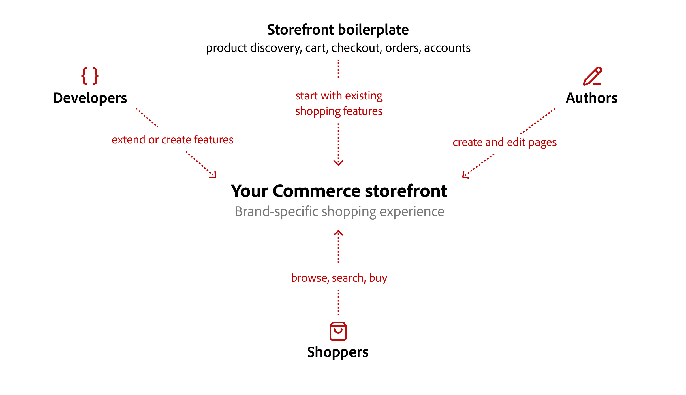
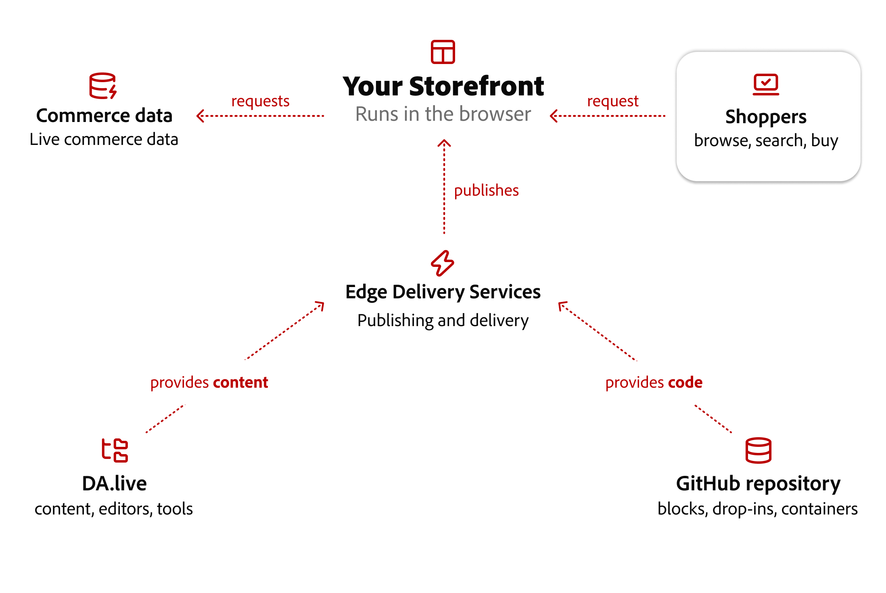
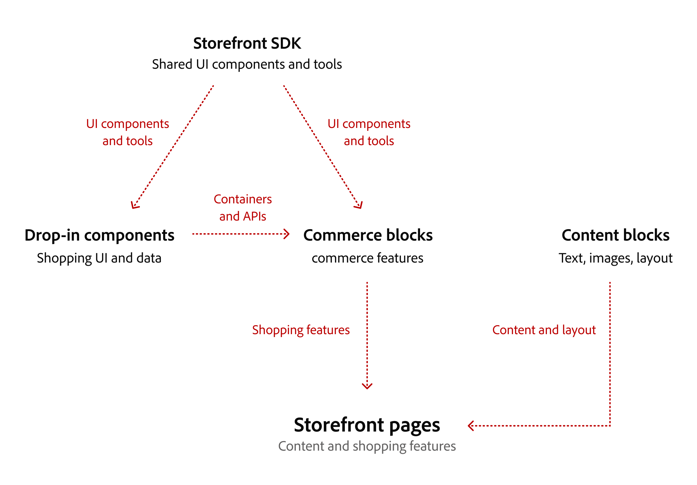

import Callouts from '@components/Callouts.astro';
import Diagram from '@components/Diagram.astro';
import Term from '@components/Term.astro';

With Adobe Commerce Storefront, you start with a codebase that includes product discovery, cart, checkout, and account features. You can adapt those features, change the storefront's design, or build new shopping experiences instead of implementing every flow from scratch. Available features depend on your [backend](/get-started/backends/) and [licensing](/licensing/).

## Your role as a storefront developer

Your codebase comes from the <Term term="Commerce boilerplate">Adobe Commerce boilerplate</Term>. You customize its code and shopping features, while content authors create and edit pages.

<Diagram caption="Your storefront starts with the Adobe Commerce boilerplate's existing shopping features. You extend or create features, and authors create and edit pages for shoppers.">
  
</Diagram>

## How your storefront reaches shoppers

You keep your code in a GitHub repository, while authors manage page content in <Term>DA.live</Term>.

<Term>Edge Delivery Services</Term> delivers that content and code to shoppers. Your storefront runs in the shopper's browser and combines the content with live shopping data from your Commerce services.

<Diagram caption="Your storefront runs in the shopper's browser, using content and code delivered by Edge Delivery Services and live data from Commerce APIs.">
  
</Diagram>

## What your storefront pages are built from

Blocks bring content and shopping features together on a page. Content blocks add text, images, and layout, while <Term>Commerce blocks</Term> add shopping features.

Commerce blocks can use <Term term="Drop-in components">drop-in components</Term> for ready-made shopping interfaces, such as cart and checkout, that connect to your Commerce services. The Storefront SDK is a software development kit with shared user interface components and tools that Commerce blocks can also use.

<Diagram caption="Storefront pages combine shopping features from Commerce blocks with content and layout from content blocks. Commerce blocks can use drop-in components and the Storefront SDK.">
  
</Diagram>

## Create and preview your first storefront

Your first goal is a working local preview connected to your Commerce catalog.

Before you begin, check [Prerequisites](/get-started/before-you-start/) for the accounts and tools you need. Review [Backend options](/get-started/backends/) and [Licensing requirements](/licensing/) to confirm the Commerce services and drop-ins available to your project.

Next, follow [Create a storefront](/get-started/create-storefront/) to create your project and add starter content. Then [run your storefront locally](/boilerplate/#running-locally).

Before you customize the storefront, confirm that your preview displays products from the catalog you configured.

## Plan your first storefront change

Once you've confirmed the catalog, explore the project and decide what you want to customize:

<Callouts columnCount={1}>
- [Explore your storefront project](/boilerplate/): Find the code, styles, and configuration you can change.
- [Understand blocks and drop-ins](/blocks/blocks-and-dropins/): Learn how the storefront's shopping features fit together.
- [Choose how to customize](/dropins/all/extend-or-create/): Decide whether to extend an existing feature or build a custom one.
</Callouts>

## More help on this topic

- When you're ready to make a change, use [Developer how-tos](/how-tos/#for-developers) for guidance on product pages, cart, checkout, accounts, and search.
- For a closer look at page delivery and Commerce data, see [Architecture](/get-started/architecture/).
- For shopping component details, use the [B2C drop-in reference](/dropins/) for business-to-consumer storefronts or the [B2B drop-in reference](/dropins-b2b/) for business-to-business storefronts.
- For shared user interface components and tools, use the [Storefront SDK](/sdk/) reference.
