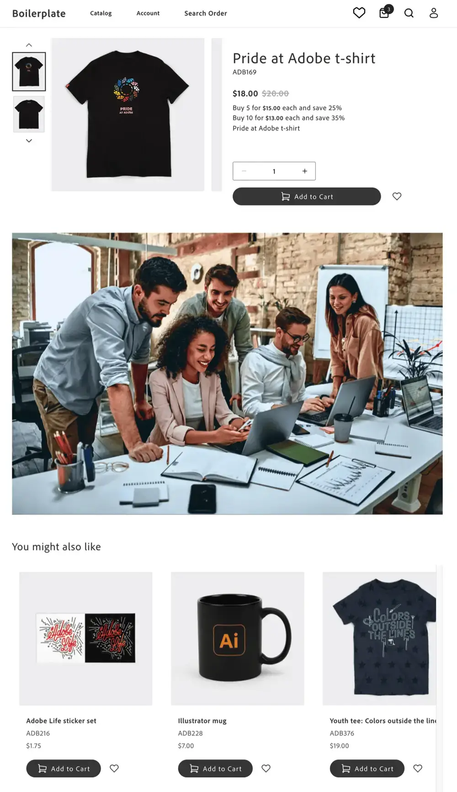
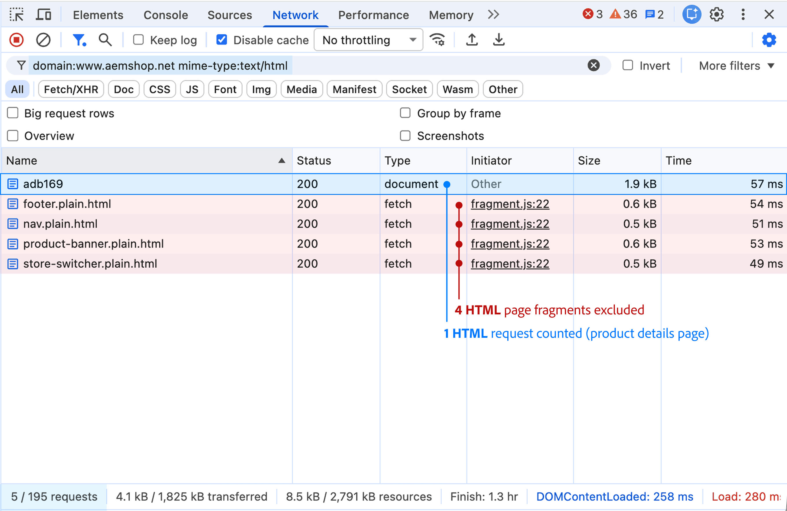
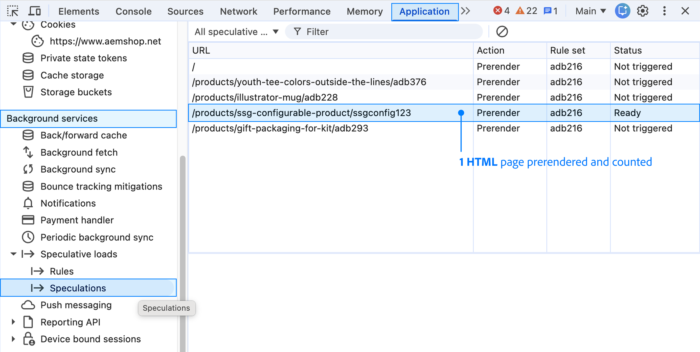

import { Aside, Steps, Tabs, TabItem } from '@astrojs/starlight/components';
import ContentRequestCalculator from '@components/ContentRequestCalculator.astro';
import Diagram from '@components/Diagram.astro';
import Link from '@components/Link.astro';
import TableWrapper from '@components/TableWrapper.astro';

A page view and a content request aren't the same thing. On the demo storefront, loading a standard page uses 1 to 1.2 content requests, before extra usage from unopened prerendered pages or automated traffic. Use this page to see what counts, forecast your usage, and compare your forecast with what Adobe measures.

## Page views vs. content requests

When a shopper views a page, the browser makes many requests, but only the page and some data files count. For example, one product page view adds up to 1.2 content requests:

<Diagram adaptColors
   type="mermaid"
   caption="How one view of the example product page adds up to about 1.2 content requests. HTML fragments, placeholder files, Commerce API calls, and static assets don't count."
   code={`flowchart LR
      PAGE["1 page view"]
      subgraph EDS["Page requests counted"]
            DOC["Page HTML<br/>1 request"]
            DATA["JSON index file<br/>1 request"]
      end
      subgraph OTHER["Page requests NOT counted"]
            FRAG["Navigation, footer, and<br/>other HTML fragments<br/>4 .plain.html requests"]
            PH["Placeholder JSON files<br/>6 requests"]
            API["Commerce API calls<br/>sent to Adobe Commerce<br/>6 requests"]
            ASSETS["Images, CSS,<br/>and JavaScript"]
      end
      PAGE --> DOC
      PAGE --> DATA
      PAGE -.-> FRAG
      PAGE -.-> PH
      PAGE -.-> API
      PAGE -.-> ASSETS
      DOC -->|1 per HTML request| DOC_UNIT["1 <br/>content request"]
      DATA -->|1 per 5 JSON requests| DATA_UNIT["1 ÷ 5 = 0.2<br/>content requests"]
      DOC_UNIT --> TOTAL["1 + 0.2 = 1.2<br/>content requests"]
      DATA_UNIT --> TOTAL
      classDef page fill:#f4f4f4,stroke:#404040,color:#262626,stroke-width:2px
      classDef html fill:#f4f4f4,stroke:#2463c7,color:#163d78,stroke-width:2px
      classDef json fill:#f4f4f4,stroke:#2463c7,color:#163d78,stroke-width:2px
      classDef counted fill:#e4f5eb,stroke:#168250,color:#145c3b,stroke-width:2px
      classDef total fill:#e4f5eb,stroke:#168250,color:#145c3b,stroke-width:3px
      classDef excluded fill:#f4f4f4,stroke:#737373,color:#404040,stroke-dasharray:4 4
      class PAGE page
      class DOC html
      class DATA json
      class DOC_UNIT,DATA_UNIT counted
      class TOTAL total
      class FRAG,PH,API,ASSETS excluded
      style EDS fill:#e8f1ff,stroke:#2463c7,stroke-width:1px
      style OTHER fill:#FFE1E8,stroke:#737373,stroke-dasharray:4 4
   `}
/>

## At a glance

The diagram shows a standard page. These factors can add to it:

- <b>Prerendering adds usage:</b> Pages loaded in advance count even if the shopper never opens them. Include these unopened pages when forecasting, especially on category and search pages. A prerendered page that the shopper then opens counts only once.
- <b>Other traffic adds usage:</b> AI agents and bots that AEM doesn't recognize, and monitoring tools, count. Well-known search, social, and AI crawlers don't.
- <b>Your forecast:</b> Enter your expected page views in the [forecast calculator](#forecast-usage).

<Aside type="note" title="How Adobe measures your usage">

Adobe counts the pages and data files that its network delivers from your production storefront. Your analytics and your estimates don't change that count. Use the estimates on this page to plan. To see measured usage and what contributes most to it, ask your Adobe team or Adobe Customer Support for a usage report.

</Aside>

## Does it count?

Your storefront delivers pages through Edge Delivery Services, part of Adobe Experience Manager (AEM), so AEM's counting rules apply. These rules cover traffic through the Adobe-managed content delivery network (CDN). If your storefront uses its own CDN, ask your Adobe team how to report your usage.

<TableWrapper>

| When this happens | Counts? | Content requests |
| ----------------- | ------- | ---------------: |
| A shopper opens a page | Yes | 1 |
| A page shows content that authors manage in a spreadsheet or index, such as product banners, store lists, or blog listings | Yes | 0.2 for each file |
| A shopper browses products, sees prices, searches, filters, uses the cart, checks out, or manages an account | No | 0 |
| A page loads images, styles, scripts, the navigation, or the footer | No | 0 |
| The browser prerenders a page, and the shopper never opens it | Yes | Same as opening the page |
| The browser prerenders a page, and the shopper then opens it | Once | Same as opening the page, not counted again |
| A shopper's browser blocks analytics | Yes | Same as any page view |
| A well-known search, social, or AI crawler visits | No | 0 |
| An AI agent, script, or bot that AEM doesn't recognize visits | Yes | Same as a shopper |
| An uptime monitor checks a page | Yes, unless it sends `HEAD` requests | 1 for each check |
| A mobile app or partner feed reads data files from your storefront domain | Yes | 0.2 for each file |
| A visitor gets a redirect or an error | No | 0 |

</TableWrapper>

### Keep automated traffic from counting

Not all AI traffic is excluded. AEM excludes automated traffic only when it recognizes a well-known bot. To keep your own automated traffic from using your allowance:

- *Monitoring:* Set uptime and health checks to send `HEAD` requests, which don't count.
- *Load tests and scripts:* Run them on your preview or staging site, because only production traffic counts.
- *Proxies and CDNs:* Pass the original user agent to AEM, so AEM can recognize well-known bots.

### Counting rules in detail

Your storefront team can use these details to check individual requests.

<details>
<summary>Requests that count</summary>

AEM counts successful responses, with status codes `100-299`, unless an exclusion applies. According to the <Link href="https://experienceleague.adobe.com/en/docs/experience-manager-cloud-service/content/implementing/using-cloud-manager/license-dashboard#what-is-a-content-request" text="AEM counting definition" />, these storefront requests count toward your allowance:

<TableWrapper>

| Request type | How it counts |
| ------------ | ------------- |
| HTML responses | Each HTML response, such as the page itself, counts as 1 content request. |
| JSON responses | Every 5 JSON responses count as 1 content request. |
| Cached responses | Count the same as responses that aren't cached. |
| Prefetched and prerendered pages | Count when loaded, even if the shopper never opens the page. See [Pages that use more content requests](#pages-that-use-more-content-requests). |
| Automated traffic | Requests from scripts, test tools, monitoring services, and AI agents that AEM doesn't recognize count. |
| Visits that analytics doesn't record | Count, because AEM counts the content it delivers, even when a shopper's browser blocks analytics. |

</TableWrapper>

</details>

<details>
<summary>JSON files that count</summary>

JSON files hold data that a page reads after it loads. On the demo storefront's home, category, and product pages, only one JSON file counts: the enrichment index. Your storefront can add more when your team builds features that read published content.

To plan usage, read the first and last columns. The middle column names the file that your storefront team sees.

<TableWrapper>

| Business use | File your storefront team sees | Content requests per view |
| ------------ | ------------------- | ------------------------: |
| Banners, size guides, and promotions on product and category pages | The enrichment index, `enrichment.json`, which lists the content to show on each product or category page | 0.2 |
| Lists that authors keep in a spreadsheet, such as store locations, FAQs, or a promotions calendar | One published spreadsheet for each list that a custom block displays | 0.2 for each spreadsheet |
| Editorial listing pages, such as a blog or lookbook | A custom index of articles. `query-index.json` is excluded, but indexes with other names, such as `enrichment.json`, count. | 0.2 for each index |
| Other apps that read your site's content, such as a mobile app, kiosk, or partner feed | Any JSON file that the app downloads from your storefront domain | 0.2 for each file, even though no shopper views a page |

</TableWrapper>

Product details, prices, search results, carts, checkout, and accounts come from Commerce API calls, which don't count toward your content request allowance.

</details>

<details>
<summary>Requests that don't count</summary>

These storefront requests don't count toward your allowance:

<TableWrapper>

| Request type | What to look for |
| ------------ | ---------------- |
| Static assets | Images, style sheets, and JavaScript files. |
| HTML fragments | URLs ending in `.plain.html`, such as `nav.plain.html`. Fragments loaded from their page URL, such as `/fragments/promo`, count normally. |
| Placeholder files | JSON files in a `placeholders/` folder, such as `/placeholders/cart.json`. These files hold the text labels that drop-in components display. |
| Common Edge Delivery JSON files | `placeholders.json`, `placeholder.json`, `query-index.json`, `form-data.json`, and `config.json`. |
| Redirects and errors | Status codes `300` and above, such as `301` or `404`. The page that a redirect leads to counts normally. |
| Commerce API calls | Requests routed directly to Adobe Commerce without reaching AEM, such as `graphql` and `cs-graphql`. Calls to other services that don't reach AEM are also excluded. |

</TableWrapper>

AEM also excludes DDoS attacks that it detects and blocks, and health checks that use `HEAD` requests. For other exclusions and ways to manage usage, see the <Link href="https://experienceleague.adobe.com/en/docs/experience-manager-cloud-service/content/implementing/using-cloud-manager/content-requests" text="AEM content request rules" />. Some exclusions on this page, such as HTML fragments, placeholder files, and `config.json`, aren't listed in the AEM documentation yet.

</details>

<details>
<summary>Bots, crawlers, and AI agents</summary>

AEM identifies bots by the user agent, the name that a browser or bot sends with each request.

<TableWrapper>

| Visitor | Counts? | Examples from AEM's lists |
| ------- | ------- | ------------------------- |
| Well-known search engine and social media crawlers | No | Googlebot, Bingbot, Applebot, Facebook, and Pinterest |
| Well-known AI crawlers | No | ChatGPT, Claudebot, Perplexity, and Gemini Deep Research |
| AI agents and automation that AEM doesn't recognize | Yes | An AI agent that identifies itself as a regular browser, headless Chrome, and scripts that use tools such as curl or Python Requests |
| Monitoring tools that send `GET` requests | Yes | UptimeRobot, Amazon Route 53 health checks, and Site24x7 |

</TableWrapper>

- *AI agents that browse for a person:* An AI assistant that opens pages on a shopper's behalf can look like a regular browser, so its requests can count.
- *Proxies and CDNs:* Recognized bots can count if a proxy or CDN in front of your storefront doesn't pass the original user agent to AEM.

For the full lists, see the <Link href="https://experienceleague.adobe.com/en/docs/experience-manager-cloud-service/content/implementing/using-cloud-manager/content-requests#server-side-collection-rules" text="AEM server-side collection rules" />.

</details>

## Pages that use more content requests

Extra pages and content data files add usage. Filtering products, adding to the cart, and moving through checkout use Commerce API calls, which don't count.

### Prerendered pages

To make navigation faster, the storefront asks browsers such as Chrome and Edge to load linked pages in advance, for example when the pointer rests on a product link.

- *Never opened:* The prerendered page counts the same as a page view, even though the shopper never sees it.
- *Opened later:* The browser shows the prerendered copy, so the page counts only once.

Home, category, and search pages have many links that can trigger prerendering. Your storefront team can adjust the speculation rules in `head.html`.

#### Example: one category page

A shopper opens a category page, hovers over products A and B, and then opens B. Both prerenders finish, and each page uses 1.2 content requests.

<TableWrapper highlightLast totalRow>

| Page | What the shopper does | Content requests |
| ---- | --------------------- | ---------------: |
| Category page | Opens it | 1.2 |
| Product A | Hovers, never opens | 1.2 |
| Product B | Hovers, then opens the prerendered copy, which counts once | 1.2 |
| Total | Two page views and one unopened prerender | 3.6 |

</TableWrapper>

- *Counted once:* Product B was prerendered and then opened, so it counts once.
- *Still counted:* Product A was never seen, but its prerender counts.
- *Not a forecast:* This short journey shows the counting rule. To estimate your storefront's average, [measure unopened prerendered pages](#unopened-prerendered-pages).

### Account and sign-in pages

When the browser loads one page and then redirects to another, both pages count:

- *Signed out:* Opening an account page, such as the address book, redirects the shopper to sign-in.
- *Signed in:* Opening the sign-in page redirects the shopper to the account page.

### Custom content blocks

Blocks that load extra content add requests for each file:

- *Spreadsheet or index:* Each adds 0.2 content requests per view.
- *Full HTML page:* Each adds 1 content request. Files ending in `.plain.html` are fragments and don't count.

To find the pages that use the most, [measure content requests per page view](#content-requests-per-page-view) on one page of each type: home, category, product, content, cart, checkout, and account.

## Measure your storefront

Each measurement fills one field in the [forecast calculator](#forecast-usage). If your storefront is live and you want site-wide numbers without developer tools, ask your Adobe team or Adobe Customer Support for a usage report.

<TableWrapper>

| Measure | Tool | Calculator field |
| ------- | ---- | ---------------- |
| [Content requests per page view](#content-requests-per-page-view) | Console script or Network panel | Content requests per view |
| [Unopened prerendered pages](#unopened-prerendered-pages) | Application panel, Speculations | Extra prerendered pages per page view |
| [Other traffic](#other-traffic) (optional) | CDN or server logs | Headroom for other traffic |

</TableWrapper>

Only production traffic counts toward your allowance. Before launch, measure on a preview or staging site with your planned production code and settings.

### Content requests per page view

Measure one page view in your browser's developer tools.

<Steps>

1. Open a page on your storefront in Chrome or Edge.

    <Diagram caption="The examples on this page use this Adobe demo product page.">
       
    </Diagram>

1. Open your browser's developer tools, select the <b>Network</b> tab, select <b>Disable cache</b>, and then reload the page.

   Disabling the cache shows the requests a first-time visitor makes. To include shopper actions in your estimate, interact with the page now.

</Steps>

Next, count the requests. The script does the counting for you. The Network panel lets you check each request yourself.

<Tabs>
<TabItem label="Run the script">

The script reads the requests that the browser already recorded for the page and applies the counting rules on this page. It doesn't change the page or send data anywhere.

<Steps>

1. Select the <b>Console</b> tab, copy the following script, paste it, and press Enter.

   ```js title="Console" collapse={2-54}
   (async () => {
     const [page] = performance.getEntriesByType('navigation');
     if (!page?.contentType?.includes('html')) {
       console.warn('This browser does not report response types. Use a current version of Chrome or Edge.');
       return;
     }
     console.log('Waiting for the page to finish loading...');
     const loading = '[data-section-status]:not([data-section-status="loaded"]), '
       + '[data-block-status]:not([data-block-status="loaded"])';
     const start = Date.now();
     let quietSince = start;
     let lastCount = 0;
     while (Date.now() - quietSince < 2000) {
       if (Date.now() - start > 30000) {
         console.warn('The page was still loading after 30 seconds. The results might be incomplete.');
         break;
       }
       const count = performance.getEntriesByType('resource').length;
       if (count !== lastCount || document.querySelector(loading)) {
         lastCount = count;
         quietSince = Date.now();
       }
       await new Promise((resolve) => setTimeout(resolve, 250));
     }
     const resources = performance.getEntriesByType('resource');
     if (resources.length >= 250) {
       console.warn('The browser might not have recorded every request. Check the results in the Network panel.');
     }
     const excluded = [
       [/\.plain\.html$/, 'HTML fragment'],
       [/\/placeholders\//, 'Placeholder file'],
       [/\/(placeholders?|query-index|form-data|config)\.json$/, 'Common Edge Delivery JSON file'],
       [/graphql$/, 'Commerce API call'],
     ];
     const rows = [];
     let html = 0;
     let json = 0;
     for (const entry of [page, ...resources]) {
       if (!entry.name.startsWith(location.origin)) continue;
       let type = '';
       if (entry.contentType.includes('html')) type = 'HTML';
       if (entry.contentType.includes('json')) type = 'JSON';
       if (!type) continue;
       const { pathname } = new URL(entry.name);
       const reason = entry.responseStatus >= 300
         ? 'Redirect or error'
         : excluded.find(([pattern]) => pattern.test(pathname))?.[1];
       if (!reason && type === 'HTML') html += 1;
       if (!reason && type === 'JSON') json += 1;
       rows.push({ request: pathname, type, counted: reason ? `No: ${reason}` : 'Yes' });
     }
     console.table(rows);
     const total = Math.round((html + json / 5) * 100) / 100;
     console.log(`Content requests per page view: ${html} HTML + ${json} JSON ÷ 5 = ${total}`);
   })();
   ```

   If Chrome warns you about pasting, type `allow pasting`, press Enter, and then paste the script again.

1. Read the result at the end of the console output.

   The script waits until the page stops loading content, which can take a few seconds after the page appears. The table lists each HTML and JSON request from your storefront's domain and whether it counts. The last line shows the total, such as `Content requests per page view: 1 HTML + 1 JSON ÷ 5 = 1.2`.

</Steps>

<Aside type="tip" title="Reuse the script">

To run the script on several pages, save it once as a snippet in the <b>Sources</b> panel, under <b>Snippets</b>. On each page, reload with the cache disabled, open the snippet, and press Ctrl+Enter (Cmd+Enter on macOS). The result appears in the console.

</Aside>

The script finds Commerce API calls by URLs that end in `graphql`. If your storefront routes Commerce requests through other paths, check those requests in the Network panel. The script measures only the current page, so it doesn't include [pages that the browser prerenders](#pages-that-use-more-content-requests).

</TabItem>
<TabItem label="Count in the Network panel">

Use this method to check individual requests, or if the script shows a warning.

<Steps>

1. In the <b>Network</b> tab, enter the following filter in the <b>Filter</b> box. Replace `www.example.com` with your storefront's domain.

   ```text showLineNumbers=false
   domain:www.example.com mime-type:text/html
   ```

   At the bottom of the Network panel, record the number before the slash as your HTML count. This number shows how many requests match the filter.

   If no requests appear, check the domain in the filter and reload the page with the **Network** tab open.

    <Diagram caption="The HTML filter lists the page document and 4 fragments.">
       
   </Diagram>

1. Replace the filter with the following one and record your JSON count the same way.

   ```text showLineNumbers=false
   domain:www.example.com mime-type:application/json
   ```

    <Diagram caption="The JSON filter lists 6 placeholder files, the enrichment index, and 6 Commerce API calls.">
     
   </Diagram>

1. Subtract requests that don't count:

   - *Redirects and errors:* a <em>Status</em> value of `300` or higher, such as `301` or `404`.
   - *HTML fragments:* names ending in `.plain.html`, such as `nav.plain.html`.
   - *Placeholder files:* any JSON file in a `placeholders/` folder, such as `cart.json` in the example. To see a request's folder, hover over its name.
   - *Common Edge Delivery JSON files:* `placeholders.json`, `placeholder.json`, `query-index.json`, `form-data.json`, or `config.json`.
   - *Commerce API calls:* JSON requests routed directly to Adobe Commerce, such as `graphql` and `cs-graphql` in the example.

   If you're not sure how a Commerce request is routed, ask your storefront team before you exclude it.

1. Divide the remaining JSON count by 5 and add it to the remaining HTML count to get the content requests per page view.

</Steps>

</TabItem>
</Tabs>

<details>
<summary>Worked example: the demo product page</summary>

For the product page in the screenshots, these steps result in about 1.2 content requests per view:

<TableWrapper highlightLast totalRow>

| Files | Browser requests | Content requests |
| ----- | ---------------- | ---------------: |
| Product page | 1 HTML | **1** |
| Fragments, such as the footer | 4 HTML | excluded = **0** |
| Enrichment index, `enrichment.json` | 1 JSON | 1 ÷ 5 = **0.2** |
| Placeholder files, such as `/placeholders/cart.json` | 6 JSON | excluded = **0** |
| `graphql` and `cs-graphql` calls | 6 JSON | excluded = **0** |
| Total | 5 HTML, 13 JSON | **1.2** |

</TableWrapper>

</details>

### Unopened prerendered pages

A page that the browser prerenders counts even if the shopper never opens it. Count these unopened pages across a browsing session.

<Steps>

1. Open a category page on your storefront in Chrome or Edge. In developer tools, select the <b>Application</b> tab. Under <b>Background services</b>, select <b>Speculative loads</b> > <b>Speculations</b>, and then reload the page.

   The list shows the links that the browser can prerender, marked <b>Not triggered</b>.

1. Browse as a shopper would, resting the pointer on product links. A completed prerender shows <b>Ready</b>.

   <Diagram caption="One page has finished prerendering and shows Ready. The other links show Not triggered.">
     
   </Diagram>

1. Before opening the next page, add the <b>Ready</b> rows to your running total of unopened pages, excluding the link you'll open. If other statuses appear, see *Canceled and repeated prerenders* below.

1. Open the next page. The list updates to show that page's links. Repeat steps 2 and 3 for about 10 page views.

1. Divide your total by the number of page views. Enter the result in the <b>Extra prerendered pages per page view</b> field in the [forecast calculator](#forecast-usage).

</Steps>

<details>
<summary>Canceled and repeated prerenders</summary>

With the storefront's moderate prerender setting, Chrome keeps up to two prerendered pages at a time. A new hover can cancel an older prerender, but the canceled page still counts.

Add these statuses to your unopened total, except for the link you open next:

<TableWrapper>

| Status | Count it? |
| ------ | --------- |
| Prefetch fallback ready | Yes. The browser kept the page's HTML. |
| Failure, with the reason "canceled due to starting a new non-eager prerender" | Yes |
| Failure, with any other reason | No |

</TableWrapper>

- *Repeated hovers:* A canceled link can load again but appears only once. Treat your count as a minimum.
- *Early cancellation:* If canceled before data files load, the page uses 1 content request instead of 1.2.

</details>

### Other traffic

CDN or server logs show counted traffic that analytics misses, such as unrecognized bots and monitoring tools. This measurement is optional. Without it, agree on a headroom value with your storefront team.

- *Separate:* Split page views, unopened prerenders, and other traffic for the same period.
- *Exclude:* Remove requests that AEM doesn't count, such as static assets and recognized crawlers.
- *Size headroom from what's left:* The gap between logs and analytics can include prerenders you already entered, so it isn't automatically your headroom.
- *Other platforms:* Their logs can identify traffic sources, but their raw request counts aren't an AEM estimate.

For example, 12,000 other content requests ÷ 120,000 forecast from page views and prerenders = 10% headroom. Enter 10 in the <b>Headroom for other traffic (%)</b> field.

## Forecast usage

The calculator estimates content requests for a period, such as a month. Gather four inputs:

<TableWrapper>

| Input | Where to get it |
| ----- | --------------- |
| Page views | Migrating: your current site's analytics. New business: traffic projections. Don't use another platform's request counts, because its pages load content differently. |
| Content requests per view | Your [page view measurements](#content-requests-per-page-view). Cache-disabled results reflect first-time visitors. Repeat visitors make fewer requests. |
| Extra prerendered pages per page view | Your [unopened prerendered pages](#unopened-prerendered-pages) result. It's a page count, not content requests. The calculator converts it and keeps it separate from your page-only estimate. |
| Headroom for other traffic | A percentage for unrecognized bots, monitoring tools, and visits that analytics misses. See [Other traffic](#other-traffic). |

</TableWrapper>

If you haven't built your storefront yet, start with values from the <Link href="https://www.aemshop.net/" text="demo storefront" />.

<ContentRequestCalculator />

- *Review:* Check the forecast with your storefront team, including planned load tests and uptime monitoring.
- *Measured usage:* After launch, your Adobe team or Adobe Customer Support can provide a usage report to compare with this forecast.
