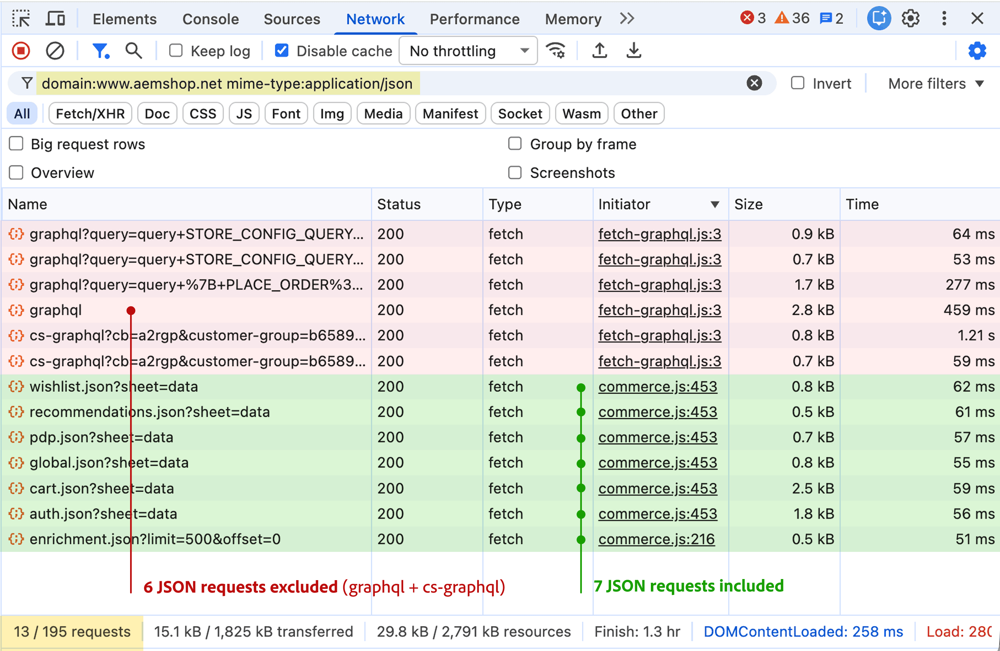

import { Aside, Steps } from '@astrojs/starlight/components';
import Diagram from '@components/Diagram.astro';
import Link from '@components/Link.astro';
import TableWrapper from '@components/TableWrapper.astro';

One page view on your storefront usually counts as more than one content request toward the allowance in your license. The shopper sees one page, but the browser builds that page from several separate requests, and each eligible request counts.

Content requests are an Adobe Experience Manager (AEM) usage measure. Your storefront pages are delivered by Edge Delivery Services, which is part of AEM, so AEM rules decide what counts. In the [example estimate](#example-estimate-for-a-product-page), one product page view adds up to about 2.4 content requests:

- **Counted:** the page HTML (1 content request) and the JSON data files (1 content request for every 5 files)
- **Not counted:** HTML fragments, such as the navigation and footer; Commerce API calls that your content delivery network (CDN) sends to Commerce; and images, style sheets, and JavaScript files

<Diagram adaptColors
  type="mermaid"
  caption="How one view of the example product page adds up to about 2.4 content requests. HTML fragments, Commerce API calls, and static assets don't count."
  code={`flowchart LR
    PAGE["1 shopper<br/>page view"]
    subgraph EDS["Counted: Page HTML and data files"]
        DOC["Page HTML<br/>1 request"]
        DATA["JSON data files<br/>7 requests"]
    end
    subgraph OTHER["Not counted"]
        FRAG["Navigation, footer, and<br/>other HTML fragments<br/>4 .plain.html requests"]
        API["Commerce API calls<br/>sent to Adobe Commerce<br/>6 requests"]
        ASSETS["Images, CSS,<br/>and JavaScript"]
    end
    PAGE --> DOC
    PAGE --> DATA
    PAGE -.-> FRAG
    PAGE -.-> API
    PAGE -.-> ASSETS
    DOC -->|1 per HTML request| DOC_UNIT["1 content<br/>request"]
    DATA -->|1 per 5 JSON requests| DATA_UNIT["1.4 content<br/>requests"]
    DOC_UNIT --> TOTAL["About 2.4<br/>content requests"]
    DATA_UNIT --> TOTAL
    classDef page fill:#f4f4f4,stroke:#404040,color:#262626,stroke-width:2px
    classDef html fill:#e8f1ff,stroke:#2463c7,color:#163d78,stroke-width:2px
    classDef json fill:#fff4cc,stroke:#9a6700,color:#684600,stroke-width:2px
    classDef counted fill:#e4f5eb,stroke:#168250,color:#145c3b,stroke-width:2px
    classDef total fill:#e4f5eb,stroke:#168250,color:#145c3b,stroke-width:3px
    classDef excluded fill:#f4f4f4,stroke:#737373,color:#404040,stroke-dasharray:4 4
    class PAGE page
    class DOC html
    class DATA json
    class DOC_UNIT,DATA_UNIT counted
    class TOTAL total
    class FRAG,API,ASSETS excluded
    style EDS fill:#f7fbff,stroke:#2463c7,stroke-width:1px
    style OTHER fill:#fafafa,stroke:#737373,stroke-dasharray:4 4
  `}
/>

## How requests are counted

Unless an [exclusion](#which-requests-are-excluded) applies, the <Link href="https://experienceleague.adobe.com/en/docs/experience-manager-cloud-service/content/implementing/using-cloud-manager/license-dashboard#what-is-a-content-request" text="AEM counting definition" /> counts responses by type:

- **HTML:** Each HTML response, such as the page itself, counts as one content request.
- **JSON:** Every five JSON responses, such as storefront data files, count as one content request.

HTML fragments are one of those exclusions. The storefront loads fragments, such as the navigation and footer, from URLs that end in `.plain.html`, and AEM doesn't count `.plain.html` responses.

<Aside type="tip" title="Forecasting usage">

To forecast usage, [estimate the content requests for representative pages](#estimate-content-requests-for-a-page), multiply each estimate by that page's expected views, and then add content requests that occur without a shopper page view. Prefetched content and bots that AEM does not recognize can add these content requests. You control how much your storefront prefetches, and AEM documents <Link href="https://experienceleague.adobe.com/en/docs/experience-manager-cloud-service/content/implementing/using-cloud-manager/content-requests#manage-content-requests" text="ways to manage content requests" />, including blocking unwanted bot traffic.

</Aside>

## Which requests count

The following traffic counts when it delivers eligible HTML or JSON page content and no exclusion applies. HTTP status codes describe the result of a request.

<TableWrapper>

| Included traffic              | Counting rule                                                                                        |
| ----------------------------- | ---------------------------------------------------------------------------------------------------- |
| HTML or JSON page content     | Included status range **100-299**, including partial content returned with **206**.                      |
| CDN cache hits                | Counted once, at the first caching system that receives the request, even when the CDN serves a cached copy. |
| Prefetched content            | Counted when fetched, even if the shopper never opens the page.                                      |
| Automation and monitoring     | Included unless a recognized bot or a specific monitoring exclusion applies.                         |
| Visits missing from analytics | Still counted when consent settings or tracking blockers prevent analytics from recording the visit. |

</TableWrapper>

## Which requests are excluded

These requests don't consume your content request allowance.

<TableWrapper>

| Excluded traffic                              | Scope of the exclusion                                                                                                      |
| --------------------------------------------- | --------------------------------------------------------------------------------------------------------------------------- |
| Static assets                                 | Images, style sheets, and JavaScript files.                                                                                 |
| HTML fragments                                | Responses whose URL ends in `.plain.html`, such as the navigation and footer that the storefront's <Link href="https://github.com/hlxsites/aem-boilerplate-commerce/blob/main/blocks/fragment/fragment.js" text="fragment loader" /> requests. |
| Redirects and errors                          | Status codes **300-399**, **400-499**, and **500** or above. A subsequent successful content request can still count.             |
| Recognized bots                               | Identified search, social, and AI crawlers. Unrecognized automation can count.                                              |
| Detected attacks                              | Traffic AEM identifies and blocks as a distributed denial-of-service attack.                                                |
| Specified health checks                       | Excluded AEM monitoring mechanisms. For Edge Delivery availability checks, AEM recommends `HEAD` instead of `GET` requests. |
| Responses from other services                 | Requests that never reach AEM, such as Commerce API calls that your CDN routes to Commerce.                                 |
| Specific Commerce Integration Framework calls | Requests made to AEM and forwarded through `/api/graphql`.                                                                  |

</TableWrapper>

<Aside type="note" title="Common counting surprises">

- An error page returned with status **200** counts. Return missing pages with status **404** so they don't consume content requests.
- A JSON response doesn't automatically count. AEM counts JSON that serves as page content and typically excludes API responses that return other data.
- A Commerce API call isn't automatically excluded. The Commerce-specific exclusions cover only calls that never reach AEM and calls forwarded through `/api/graphql`.

</Aside>

For all exclusions, including AEM internal requests and specific content reuse rules, see <Link href="https://experienceleague.adobe.com/en/docs/experience-manager-cloud-service/content/implementing/using-cloud-manager/content-requests" text="AEM content request rules" />.

## Estimate content requests for a page

Your browser's network tools list the requests a page makes, so you can estimate the content requests for any storefront page. These steps use the <Link href="https://developer.chrome.com/docs/devtools/network/reference" text="Chrome DevTools Network panel" />. Other browsers have similar tools. The screenshots in these steps show requests from a product page on an Adobe demo storefront.

<Diagram caption="The demo storefront product page used for the screenshots and the example estimate.">
  
</Diagram>

<Steps>

1. Open a page on your production site in Chrome.

   Only production traffic counts toward your allowance.

1. Open your browser's developer tools, and then select the **Network** tab.

1. Select <b>Disable cache</b>, and then reload the page.

   Disabling the cache shows the requests a first-time visitor makes. DevTools lists only the requests made while it is open, so reload the page after you open it.

1. In the <b>Filter</b> box, enter the following filter. Replace `www.example.com` with your storefront's domain.

   ```text showLineNumbers=false
   domain:www.example.com mime-type:text/html
   ```

   The status bar at the bottom of the panel shows the number of matching requests, followed by the total. Record the first number as your listed HTML count.

   <Diagram caption="The HTML filter lists the page document and four fragments.">
     
   </Diagram>

1. Replace the filter with the following one, and record your listed JSON count the same way.

   ```text showLineNumbers=false
   domain:www.example.com mime-type:application/json
   ```

   <Diagram caption="The JSON filter lists seven storefront data files and six Commerce API calls.">
     
   </Diagram>

1. Subtract the listed requests that don't count:

   - Redirects and errors: any request whose Status column shows a value outside **200** to **299**, such as **301** or **404**.
   - HTML fragments: any request whose name ends in `.plain.html`, such as `nav.plain.html` or `footer.plain.html`.
   - Commerce API calls: any request whose name starts with `graphql` or `cs-graphql`. Your CDN routes these to Commerce, so they never reach AEM.

   You don't need to check for other exclusions. The filters already hide images, style sheets, scripts, and requests to other domains, and your own browser visit isn't bot or monitoring traffic.

1. Add your remaining HTML count to your remaining JSON count divided by five.

</Steps>

## Example estimate for a product page

The following table applies the [estimation steps](#estimate-content-requests-for-a-page) to the product page in the screenshots. The four fragments use `.plain.html` URLs, and that storefront's CDN routes its `graphql` and `cs-graphql` paths to Commerce, so neither group counts.

<TableWrapper nowrap={[0]} highlightLast totalRow>

| Requests                                   | Counts                | Possible                  | Rule                                                                                      | Content requests                  |
| ------------------------------------------ | --------------------------- | ---------------------------------- | ----------------------------------------------------------------------------------------- | :-------------------------------: |
| Product page                      | 1 HTML request              | **1**                                  | Included: [HTML or JSON page content](#which-requests-count)                              | **1**                                 |
| Fragments, such as footer, nav, etc.        | 4 HTML requests             | **4**                                  | **Excluded** [HTML fragments](#which-requests-are-excluded)                               | **0**                             |
| Storefront data files, such as cart.json | 7 JSON requests             | **1.4**  (7 ÷ 5)                        | Included: [HTML or JSON page content](#which-requests-count)                              | **1.4**                               |
| graphql and cs-graphql calls           | 6 JSON requests             | **1.2** (6 ÷ 5)                         | **Excluded** [Responses from other services](#which-requests-are-excluded)                   | **0**                                 |
| **TOTAL FOR PAGE**                         | 5 HTML and 13 JSON requests | **7.6** (1+4+1.4+1.2)              | **Excluded** 4 fragments (-4) and 6 Commerce API calls (-1.2)                             | **2.4**                           |

</TableWrapper>

<Aside type="note" title="Estimated versus measured usage">

Treat the result as an estimate for one visit, not a measured total. Your reported usage can differ for these reasons:

- Repeat visitors can load some responses from their browser cache.
- Shoppers can trigger more requests as they use the page. To include those requests, use the page with DevTools open before you record your counts.
- Bots and monitoring tools also load pages, and their requests count unless an exclusion applies.

To see measured usage and what drives it, ask your Adobe team for a top usage report.

</Aside>
