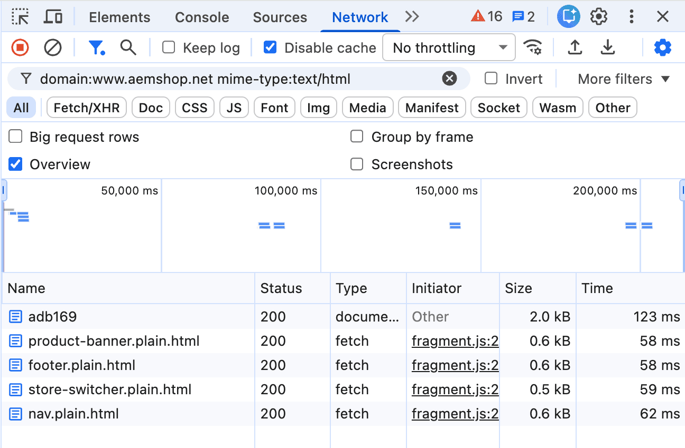
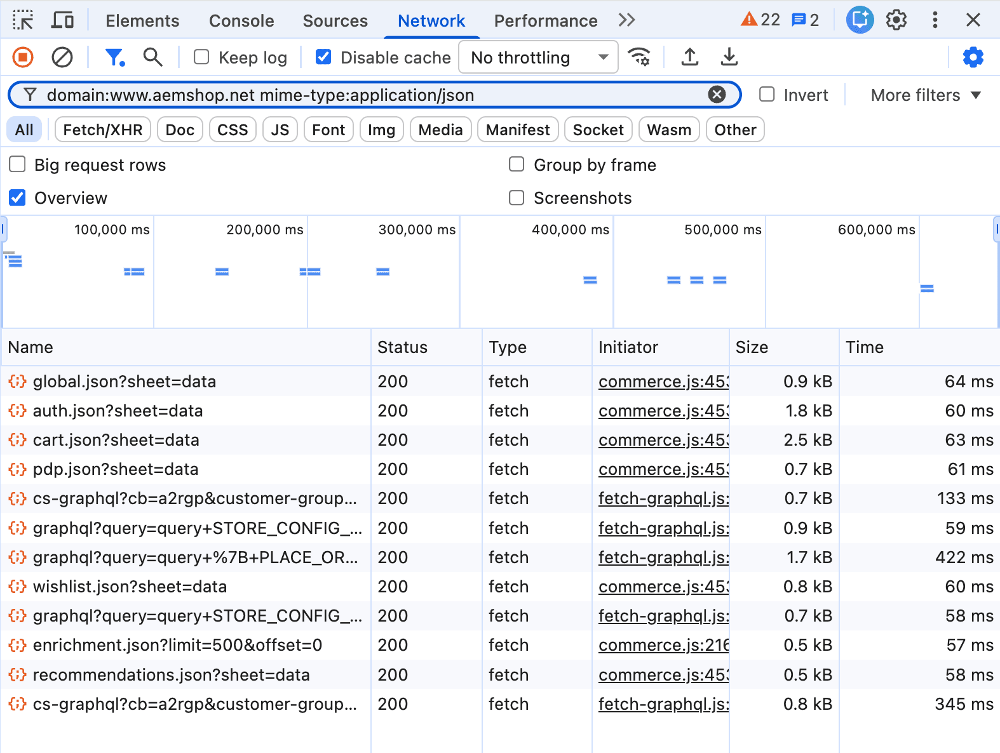

import { Aside, Steps } from '@astrojs/starlight/components';
import Diagram from '@components/Diagram.astro';
import Link from '@components/Link.astro';
import TableWrapper from '@components/TableWrapper.astro';

When a shopper opens a page, their browser requests HTML and may fetch JSON data through API calls. These requests can count toward the content request allowance included in your license.

## How requests are counted

Under the <Link href="https://experienceleague.adobe.com/en/docs/experience-manager-cloud-service/content/implementing/using-cloud-manager/license-dashboard#what-is-a-content-request" text="AEM counting definition" />, one HTML page view or five eligible JSON content API calls count as one content request. An API call asks a service for data. Only requests that meet the inclusion rules count.

<Diagram adaptColors
  type="mermaid"
  caption="Eligible HTML requests and JSON content API calls have different counting rates."
  code={`flowchart LR
    HTML["1 eligible<br/>HTML request"] -->|counts as| HTML_UNIT["1 content<br/>request"]
    JSON["5 eligible JSON content<br/>API calls"] -->|counts as| JSON_UNIT["1 content<br/>request"]
    classDef html fill:#e8f1ff,stroke:#2463c7,color:#163d78,stroke-width:2px
    classDef json fill:#fff4cc,stroke:#9a6700,color:#684600,stroke-width:2px
    classDef counted fill:#e4f5eb,stroke:#168250,color:#145c3b,stroke-width:2px
    class HTML html
    class JSON json
    class HTML_UNIT,JSON_UNIT counted
  `}
/>

AEM measures production traffic at the first caching system that receives the request. A response served from a content delivery network (CDN) cache still counts if it qualifies. Fetching it again from the original server does not add another content request.

## Why page views differ

A shopper page view can generate several content requests. The total depends on the eligible HTML and JSON content the page loads. Static assets, such as images, CSS, and JavaScript, do not consume the content request allowance.

<Diagram adaptColors
  type="mermaid"
  caption="One page view can generate several content requests. Eligible HTML and JSON content count toward the content request allowance, but static assets do not."
  code={`flowchart LR
    PAGE["One shopper<br/>page view"] --> HTML["Eligible HTML content<br/>Counts as content requests"]
    PAGE --> JSON["Eligible JSON content<br/>Counts as content requests"]
    PAGE --> ASSETS["Images, CSS and JavaScript<br/>Do not count as content requests"]
    classDef page fill:#e4f5eb,stroke:#168250,color:#145c3b,stroke-width:2px
    classDef content fill:#e8f1ff,stroke:#2463c7,color:#163d78,stroke-width:2px
    classDef excluded fill:#f4f4f4,stroke:#737373,color:#404040,stroke-dasharray:4 4
    class PAGE page
    class HTML,JSON content
    class ASSETS excluded
  `}
/>

<Aside type="tip" title="Forecasting usage">

To forecast usage, [estimate the content requests for representative pages](#estimate-content-requests-for-a-page), multiply each estimate by that page's expected views, and then add content requests that occur without a shopper page view. Prefetched content and bots that AEM does not recognize can add these content requests. You control how much your storefront prefetches, and AEM documents <Link href="https://experienceleague.adobe.com/en/docs/experience-manager-cloud-service/content/implementing/using-cloud-manager/content-requests#manage-content-requests" text="ways to manage content requests" />, including blocking unwanted bot traffic. To see what drives your usage, ask your Adobe team for a top usage report.

</Aside>

## Which requests count

The following traffic counts when it delivers eligible HTML or JSON page content and no exclusion applies. HTTP status codes describe the result of a request.

<TableWrapper>

| Included traffic              | Counting rule                                                                                        |
| ----------------------------- | ---------------------------------------------------------------------------------------------------- |
| HTML or JSON page content     | Included status range `100-299`, including partial content returned with `206`.                      |
| CDN cache hits                | Counted even when the CDN already has a copy of the content.                                         |
| Prefetched content            | Counted when fetched, even if the shopper never opens the page.                                      |
| Automation and monitoring     | Included unless a recognized bot or a specific monitoring exclusion applies.                         |
| Visits missing from analytics | Still counted when consent settings or tracking blockers prevent analytics from recording the visit. |

</TableWrapper>

## Which requests are excluded

These requests do not consume the content request allowance under the AEM rules.

<TableWrapper>

| Excluded traffic                              | Scope of the exclusion                                                                                                      |
| --------------------------------------------- | --------------------------------------------------------------------------------------------------------------------------- |
| Static assets                                 | Images, style sheets, and JavaScript files.                                                                                 |
| Redirects and errors                          | Status codes `300-399`, `400-499`, and `500` or above. A subsequent successful content request can still count.             |
| Recognized bots                               | Identified search, social, and AI crawlers. Unrecognized automation can count.                                              |
| Detected attacks                              | Traffic AEM identifies and blocks as a distributed denial-of-service attack.                                                |
| Specified health checks                       | Excluded AEM monitoring mechanisms. For Edge Delivery availability checks, AEM recommends `HEAD` instead of `GET` requests. |
| Responses from other services                 | Requests that never reach AEM, such as Commerce API calls that your CDN routes to Commerce.                                 |
| Specific Commerce Integration Framework calls | Requests made to AEM and forwarded through `/api/graphql`. This does not exclude every Commerce API call.                   |

</TableWrapper>

<Aside type="note" title="Common counting surprises">

- An error page returned with status `200` counts. Return missing pages with status `404` so they don't consume content requests.
- A JSON response doesn't automatically count. AEM counts JSON that serves as page content and typically excludes API responses that return other data.
- A Commerce API call isn't automatically excluded. The Commerce-specific exclusions cover only calls that never reach AEM and calls forwarded through `/api/graphql`.

</Aside>

For all exclusions, including AEM internal requests and specific content reuse rules, see <Link href="https://experienceleague.adobe.com/en/docs/experience-manager-cloud-service/content/implementing/using-cloud-manager/content-requests" text="AEM content request rules" />.

## Estimate content requests for a page

Your browser's network tools list the requests a page makes, so you can estimate the content requests for any storefront page. These steps use the <Link href="https://developer.chrome.com/docs/devtools/network/reference" text="Chrome DevTools Network panel" />. Other browsers have similar tools. The screenshots in these steps show requests from a product page on an Adobe demo storefront.

<Diagram adaptColors caption="The demo storefront product page used for the screenshots and the example estimate.">
  
</Diagram>

<Steps>

1. Open a page on your production site in Chrome.

   Only production traffic counts toward your allowance.

1. Open your browser's developer tools, and then select the **Network** tab.

1. Select **Disable cache**, and then reload the page.

   Disabling the cache shows the requests a first-time visitor makes. DevTools lists only the requests made while it is open, so reload the page after you open it.

1. In the **Filter** box, enter the following filter. Replace `www.example.com` with your storefront's domain.

   ```text showLineNumbers=false
   domain:www.example.com mime-type:text/html
   ```

   The status bar at the bottom of the panel shows the number of matching requests, followed by the total. Record the first number as your listed HTML count.

   <Diagram adaptColors caption="The HTML filter lists the page document and four fragments.">
     
   </Diagram>

1. Replace the filter with the following one, and record your listed JSON count the same way.

   ```text showLineNumbers=false
   domain:www.example.com mime-type:application/json
   ```

   <Diagram adaptColors caption="The JSON filter lists seven storefront data files and five Commerce API calls.">
     
   </Diagram>

1. Subtract the listed requests that don't count:

   - Redirects and errors: any request whose Status column shows a value outside `200` to `299`, such as `301` or `404`.
   - Commerce API calls: any request whose name starts with `graphql` or `cs-graphql`. Your CDN routes these to Commerce, so they never reach AEM.

   You don't need to check for other exclusions. The filters already hide images, style sheets, scripts, and requests to other domains, and your own browser visit isn't bot or monitoring traffic.

1. Add your remaining HTML count to your remaining JSON count divided by five.

</Steps>

## Example estimate for a product page

The following table applies the [estimation steps](#estimate-content-requests-for-a-page) to the product page in the screenshots. That storefront's CDN routes its `graphql` and `cs-graphql` paths to Commerce, so those five JSON requests don't count.

<TableWrapper nowrap={[1]}>

| Requests                                   | From Network filter        | Content requests before exclusions | Rule applied                                                                              | Content requests after exclusions |
| ------------------------------------------ | --------------------------- | ---------------------------------- | ----------------------------------------------------------------------------------------- | --------------------------------- |
| Product page                      | 1 HTML request              | **1**                                  | Included: [HTML or JSON page content](#which-requests-count)                              | 1                                 |
| Fragments, such as footer, nav, etc.        | 4 HTML requests             | **4**                                  | Included: [HTML or JSON page content](#which-requests-count)                              | 4                                 |
| Storefront data files, such as cart.json | 7 JSON requests             | **1.4**  (7 ÷ 5)                        | Included: [HTML or JSON page content](#which-requests-count)                              | 1.4                               |
| graphql and cs-graphql calls           | 5 JSON requests             | **1** (5 ÷ 5)                         | **Excluded:** [Responses from other services](#which-requests-are-excluded)                   | **0**                                 |
| **TOTAL FOR PAGE**                         | 5 HTML and 12 JSON requests | **7.4** (1 + 4 + 1.4 + 1)              | **Excluded:** 5 JSON requests: [Responses from other services](#which-requests-are-excluded) | **6.4** (1 + 4 + 1.4 + 0)            |

</TableWrapper>

The [responses from other services](#which-requests-are-excluded) exclusion removes the five `graphql` and `cs-graphql` calls, which lowers the estimate from 7.4 to 6.4 content requests for each first-time visit to this page.

<Aside type="note" title="Estimated versus measured usage">

Treat the result as an estimate for one visit, not a measured total. Your reported usage can differ for these reasons:

- Repeat visitors can load some responses from their browser cache.
- Shoppers can trigger more requests as they use the page. To include those requests, use the page with DevTools open before you record your counts.
- Bots and monitoring tools also load pages, and their requests count unless an exclusion applies.

Your Adobe team's top usage report shows measured usage.

</Aside>
