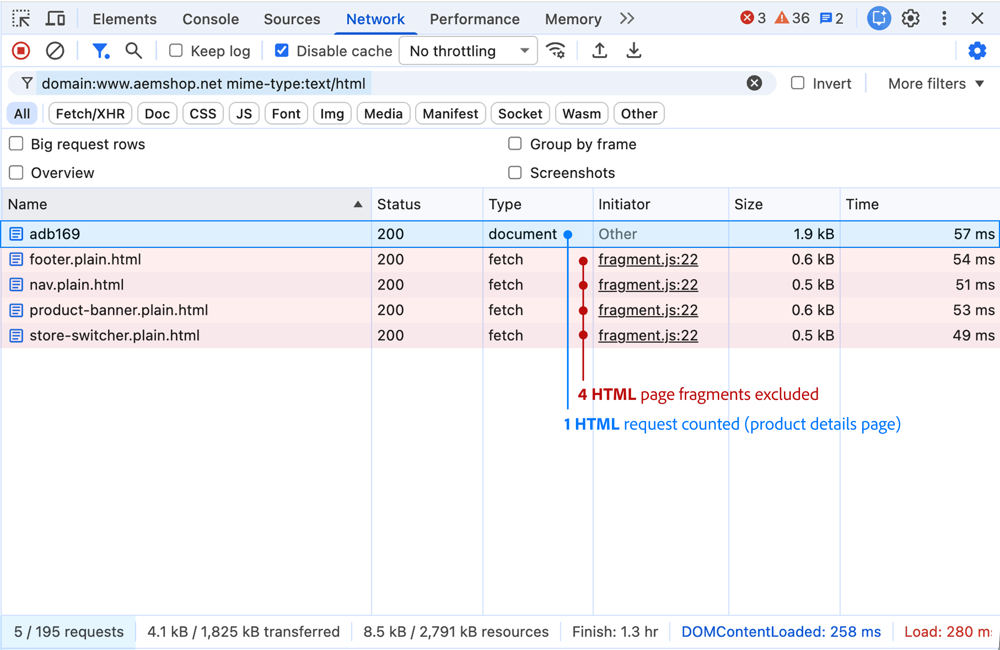
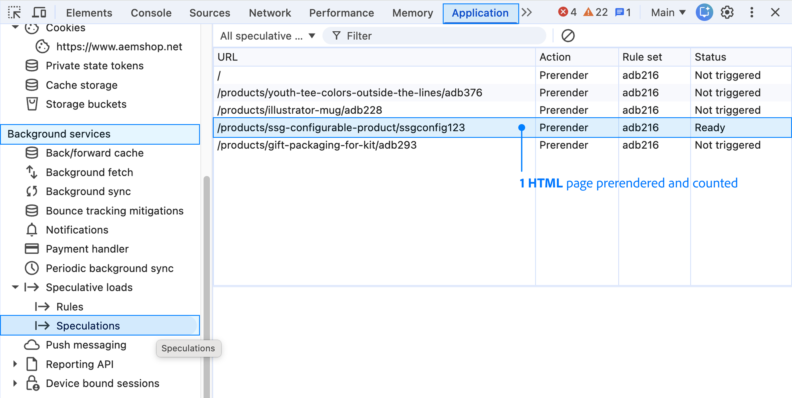

import { Aside, Steps, Tabs, TabItem } from '@astrojs/starlight/components';
import ContentRequestCalculator from '@components/ContentRequestCalculator.astro';
import Diagram from '@components/Diagram.astro';
import Link from '@components/Link.astro';
import TableWrapper from '@components/TableWrapper.astro';

Measure your storefront, then forecast its usage. For what counts as a content request, see [Content requests overview](/setup/launch/content-requests/).

## Quick start

The forecast calculator uses these inputs:

<TableWrapper>

| Input | How to get it |
| ----- | ------------- |
| Monthly page views by page type | Existing-site analytics or traffic projections |
| Content requests per page view | Measure representative pages in Chrome or Edge |
| Unopened prerenders per page view | Observe speculative loads while browsing as a shopper |
| Headroom for other traffic (optional) | Compare CDN or server logs with analytics |

</TableWrapper>

## Measure content requests per page view

Measure a representative page of each type to estimate the content requests per page view for your forecast. Page types to measure include home, category, product, content, cart, checkout, and account pages.

Use the results in the [forecast calculator](#forecast-usage):

- *Home, category, and product pages:* Enter each measurement in its matching row.
- *All other pages:* Enter the average of your remaining measurements.

<Aside type="note" title="Account pages">

Sign in before measuring an account page. Otherwise, the page sends you to sign-in, and you measure the sign-in page instead. For how both pages count, see [Account and sign-in pages](#account-and-sign-in-pages).

</Aside>

<Steps>

1. Open a page on your storefront in Chrome or Edge.

    <Diagram caption="The examples on this page use this Adobe demo product page.">
       
    </Diagram>

1. Open your browser's developer tools, select the <b>Network</b> tab, select <b>Disable cache</b>, and then reload the page.

   Disabling the cache shows the requests a first-time visitor makes.

</Steps>

You don't need to interact with the page. Actions that only send Commerce API calls add no content requests. A new page is a separate page view, and [unopened prerendered pages](#unopened-prerendered-pages) are measured separately.

Count the requests with the script, or check each one in the Network panel.

<Tabs>
<TabItem label="Run the script">

The script applies the [counting rules](#counting-rules-in-detail) to requests the browser already recorded. It doesn't change the page or send data anywhere.

<Steps>

1. Select the <b>Console</b> tab, copy the following script, paste it, and press Enter.

   ```js title="Console" collapse={2-54}
   (async () => {
     const [page] = performance.getEntriesByType('navigation');
     if (!page?.contentType?.includes('html')) {
       console.warn('This browser does not report response types. Use a current version of Chrome or Edge.');
       return;
     }
     console.log('Waiting for the page to finish loading...');
     const loading = '[data-section-status]:not([data-section-status="loaded"]), '
       + '[data-block-status]:not([data-block-status="loaded"])';
     const start = Date.now();
     let quietSince = start;
     let lastCount = 0;
     while (Date.now() - quietSince < 2000) {
       if (Date.now() - start > 30000) {
         console.warn('The page was still loading after 30 seconds. The results might be incomplete.');
         break;
       }
       const count = performance.getEntriesByType('resource').length;
       if (count !== lastCount || document.querySelector(loading)) {
         lastCount = count;
         quietSince = Date.now();
       }
       await new Promise((resolve) => setTimeout(resolve, 250));
     }
     const resources = performance.getEntriesByType('resource');
     if (resources.length >= 250) {
       console.warn('The browser might not have recorded every request. Check the results in the Network panel.');
     }
     const excluded = [
       [/\.plain\.html$/, 'HTML fragment'],
       [/\/placeholders\//, 'Placeholder file'],
       [/\/(placeholders?|query-index|form-data|config)\.json$/, 'Common Edge Delivery JSON file'],
       [/graphql$/, 'Commerce API call'],
     ];
     const rows = [];
     let html = 0;
     let json = 0;
     for (const entry of [page, ...resources]) {
       if (!entry.name.startsWith(location.origin)) continue;
       let type = '';
       if (entry.contentType.includes('html')) type = 'HTML';
       if (entry.contentType.includes('json')) type = 'JSON';
       if (!type) continue;
       const { pathname } = new URL(entry.name);
       const reason = entry.responseStatus >= 300
         ? 'Redirect or error'
         : excluded.find(([pattern]) => pattern.test(pathname))?.[1];
       if (!reason && type === 'HTML') html += 1;
       if (!reason && type === 'JSON') json += 1;
       rows.push({ request: pathname, type, counted: reason ? `No: ${reason}` : 'Yes' });
     }
     console.table(rows);
     const total = Math.round((html + json / 5) * 100) / 100;
     console.log(`Content requests per page view: ${html} HTML + ${json} JSON ÷ 5 = ${total}`);
   })();
   ```

   If Chrome warns you about pasting, type `allow pasting`, press Enter, and then paste the script again.

1. Read the result at the end of the console output.

   The script waits a few seconds for the page to finish loading. The table lists each HTML and JSON request from your storefront's domain and whether it counts. The last line shows the total, such as `Content requests per page view: 1 HTML + 1 JSON ÷ 5 = 1.2`.

</Steps>

<Aside type="tip" title="Reuse the script">

To run the script on several pages, save it as a snippet under <b>Sources</b> > <b>Snippets</b>. On each page, reload with the cache disabled, open the snippet, and press Ctrl+Enter (Cmd+Enter on macOS).

</Aside>

The script identifies Commerce API calls by URLs ending in `graphql`. Check Commerce requests on other paths in the Network panel.

</TabItem>
<TabItem label="Count in the Network panel">

Use this method to check individual requests, or if the script shows a warning.

<Steps>

1. In the <b>Network</b> tab, enter the following filter in the <b>Filter</b> box. Replace `www.example.com` with your storefront's domain.

   ```text showLineNumbers=false
   domain:www.example.com mime-type:text/html
   ```

   At the bottom of the Network panel, record the number before the slash as your HTML count.

   If nothing appears, check the domain and reload with the <b>Network</b> tab open.

    <Diagram caption="The HTML filter lists the page document and 4 fragments.">
       
   </Diagram>

1. Replace the filter with the following one and record your JSON count the same way.

   ```text showLineNumbers=false
   domain:www.example.com mime-type:application/json
   ```

    <Diagram caption="The JSON filter lists 6 placeholder files, the enrichment index, and 6 Commerce API calls.">
     
   </Diagram>

1. Subtract requests that don't count:

   - *Redirects and errors:* a <em>Status</em> value of `300` or higher, such as `301` or `404`.
   - *HTML fragments:* names ending in `.plain.html`, such as `nav.plain.html`.
   - *Placeholder files:* any JSON file in a `placeholders/` folder, such as `cart.json` in the example. To see a request's folder, hover over its name.
   - *Common Edge Delivery JSON files:* `placeholders.json`, `placeholder.json`, `query-index.json`, `form-data.json`, or `config.json`.
   - *Commerce API calls:* JSON requests routed directly to Adobe Commerce, such as `graphql` and `cs-graphql` in the example.

   If you're not sure how a Commerce request is routed, ask your storefront team before you exclude it.

1. Divide the remaining JSON count by 5 and add it to the remaining HTML count to get the content requests per page view.

</Steps>

</TabItem>
</Tabs>

### Example summary

The demo product pages each use 1.2 content requests per view:

<TableWrapper highlightLast totalRow>

| Files | Browser requests | Content requests |
| ----- | ---------------- | ---------------: |
| Product page | 1 HTML | **1** |
| Fragments, such as the footer | 4 HTML | excluded = **0** |
| Enrichment index, `enrichment.json` | 1 JSON | 1 ÷ 5 = **0.2** |
| Placeholder files, such as `/placeholders/cart.json` | 6 JSON | excluded = **0** |
| `graphql` and `cs-graphql` calls | 6 JSON | excluded = **0** |
| Total | 5 HTML, 13 JSON | **1.2** |

</TableWrapper>

## Unopened prerendered pages

A prerendered page loads its HTML and JSON files, as if the shopper were opening it, so it uses the same content requests. If the shopper then opens it, it counts only once, as a regular page view. Only unopened prerendered pages add content requests. For an example, see [Calculating prerendered content requests](/setup/launch/content-requests/#calculating-prerendered-content-requests).

The calculator needs a rate: the average number of unopened prerendered pages per page view. It multiplies that rate by your forecast page views and your average content requests per view.

To find the rate, browse about 10 pages as if you were a shopper. Keep a running total of pages that prerender but that you don't open.

<Diagram
  adaptColors
  caption="Subtract the prerendered pages you open from each page's total. Add the unopened pages, then divide by the 10 page views."
>
  
</Diagram>

<Steps>

1. Open a category page on your storefront in Chrome or Edge. In developer tools, select the <b>Application</b> tab. Under <b>Background services</b>, select <b>Speculative loads</b> > <b>Speculations</b>, and then reload the page.

   The list shows the links that the browser can prerender, marked <b>Not triggered</b>.

1. Browse as a shopper, resting the pointer on product links. A completed prerender shows <b>Ready</b>.

   <Diagram caption="One page has finished prerendering and shows Ready. The other links show Not triggered.">
     
   </Diagram>

1. Before opening the next page, add each row that no longer shows <b>Not triggered</b>, such as <b>Ready</b> or <b>Failure</b>, to your running total of unopened pages. Leave out the link you'll open, which counts as your next page view. Include canceled prerenders, because their files may already have loaded.

1. Open the next page, and then repeat steps 2 and 3 until you've viewed about 10 pages.

1. Divide your total of unopened pages by the number of pages you viewed. For example, 4 unopened pages across 10 page views is 0.4. Enter the result in the <b>Unopened prerendered pages per page view</b> field in the [forecast calculator](#forecast-usage).

</Steps>

## Other traffic

This optional measurement uses CDN or server logs to find counted traffic that analytics misses, such as unrecognized bots and monitoring tools. Without it, agree on a headroom value with your storefront team.

- *Separate:* Split page views, unopened prerenders, and other traffic for the same period.
- *Exclude:* Remove requests that AEM doesn't count, such as static assets and recognized crawlers.
- *Calculate headroom from remaining traffic:* The gap between logs and analytics can include prerenders you already entered, so it isn't automatically your headroom.
- *Other platforms:* Their logs can identify traffic sources, but their raw request counts aren't an AEM estimate.

For example, your logs show 120,000 content requests from page views and prerenders, and 12,000 from other traffic, in the same period. The headroom is 12,000 ÷ 120,000 = 10%. Enter 10 in the <b>Headroom for other traffic (%)</b> field.

## Forecast usage

Use your current site's analytics or traffic projections for monthly page views, then enter the measurements from the sections above. Don't use another platform's request counts, because its pages load content differently.

Replace the example values with your own. If your storefront isn't built yet, use the example measurements from the <Link href="https://www.aemshop.net/" text="demo storefront" /> as a starting point.

<ContentRequestCalculator />

<Diagram
  adaptColors
  caption="The three columns use the calculator's default values. Read each calculation from top to bottom."
>
  
</Diagram>

Your license includes a monthly content-request allowance. Adobe compares usage against the total allowance for each 12-month period, so lower usage in quieter months can offset higher usage in busier months.

<Aside type="note" title="Forecast assumptions">

- *Repeat visitors:* Measurements taken with caching disabled can overestimate requests from repeat visits.
- *Prerenders:* The estimate uses your average content requests per view. Actual usage varies with the pages prerendered and whether they finish loading.

</Aside>

## Counting rules in detail

For how HTML and JSON requests count, see the <Link href="https://experienceleague.adobe.com/en/docs/experience-manager-cloud-service/content/implementing/using-cloud-manager/license-dashboard#what-is-a-content-request" text="AEM counting definition" />. For response codes, caching, bots, monitoring, and other exclusions, see the <Link href="https://experienceleague.adobe.com/en/docs/experience-manager-cloud-service/content/implementing/using-cloud-manager/content-requests#server-side-collection-rules" text="AEM server-side collection rules" />.

### Storefront-specific exclusions

- *HTML fragments:* Files ending in `.plain.html`, such as `nav.plain.html`, don't count. Fragments loaded from their page URL, such as `/fragments/promo`, count normally.
- *Placeholder and common Edge Delivery JSON files:* JSON files in a `placeholders/` folder, plus `placeholders.json`, `placeholder.json`, `query-index.json`, `form-data.json`, and `config.json`, don't count.
- *Commerce API calls:* Requests sent directly to Adobe Commerce, such as `graphql` and `cs-graphql`, or to other services without reaching AEM, don't count.

Some of these file exclusions aren't listed in the AEM documentation yet.

### JSON files that count

JSON files hold data that a page reads after it loads. On the demo storefront's home, category, and product pages, only one JSON file counts: the enrichment index. Your storefront can add more when your team builds features that read published content.

<TableWrapper>

| Business use | File your storefront team sees | Content requests per view |
| ------------ | ------------------- | ------------------------: |
| Banners, size guides, and promotions on product and category pages | The enrichment index, `enrichment.json` | 0.2 |
| Lists that authors keep in a spreadsheet, such as store locations, FAQs, or a promotions calendar | One published spreadsheet for each list that a custom block displays | 0.2 for each spreadsheet |
| Editorial listing pages, such as a blog or lookbook | A custom article index. `query-index.json` is excluded, but indexes with other names count. | 0.2 for each index |
| Other apps that read your site's content, such as a mobile app, kiosk, or partner feed | Any JSON file that the app downloads from your storefront domain | 0.2 for each file, even though no shopper views a page |

</TableWrapper>

Product details, prices, search results, carts, checkout, and accounts come from Commerce API calls, which don't count toward your content request allowance.

## Account and sign-in pages

When a loaded page uses JavaScript to send the shopper to another page, both pages count:

- *Signed out:* Opening an account page, such as the address book, redirects the shopper to sign-in.
- *Signed in:* Opening the sign-in page redirects the shopper to the account page.

An HTTP redirect, such as `301` or `302`, doesn't count, but the page it leads to does.

## Custom content blocks

Blocks that load extra content add requests for each file:

- *Spreadsheet or index:* Each adds 0.2 content requests per view.
- *Full HTML page:* Each adds 1 content request. Files ending in `.plain.html` are fragments and don't count.

## Keep automated traffic from counting

For monitoring and proxy settings, see the <Link href="https://experienceleague.adobe.com/en/docs/experience-manager-cloud-service/content/implementing/using-cloud-manager/content-requests#implementation-techniques-to-manage-content-requests" text="AEM guidance for managing content requests" />. Run load tests and scripts on your preview or staging site, because only production traffic counts.
