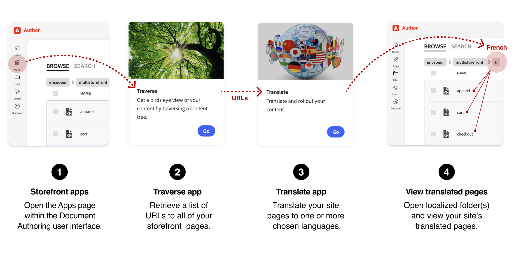

import { Steps } from '@astrojs/starlight/components';
import Tasks from '@components/Tasks.astro';
import Task from '@components/Task.astro';
import Diagram from '@components/Diagram.astro';
import Aside from '@components/Aside.astro';
import Link from '@components/Link.astro';

Translate storefront page documents with the Translate app in Document Authoring (DA.live), then review the translated content before publishing. Your development team handles the Commerce settings and storefront labels that need separate checks.

## Prerequisites

- Access to your storefront project in <Link href="https://da.live" text="Document Authoring" /> and familiarity with [the document workflow](/merchants/quick-start/document-authoring/).
- Previewed or published source pages from the same site.
- A [multistore setup](/setup/configuration/multistore-setup/) with the folder structure, store views, currency, and headers configured by your development team.

## Translation workflow

Collect the page URLs, create a translation project, and review the translated documents before handing off the Commerce checks.

<Diagram caption="Workflow for localizing your storefront">
  
</Diagram>

## Translate English pages to French

This example translates English page content to French (`fr`). Replace the example organization and site path, `/acme/storefront`, with your project's path, and use a descriptive translation project title instead of `acme-storefront-fr`.

<Tasks>

<Task>
### Open your storefront apps

Start in the project that contains the pages to translate.

<Steps>
1. Open your storefront project in <Link href="https://da.live" text="Document Authoring" />.
1. Select **Apps** from the left sidebar.

</Steps>

</Task>

<Task>
### Collect the page URLs

The Traverse app lists the pages in your project so you can choose which ones to translate.

<Steps>
1. Open the **Traverse** app.
1. On the **Crawl Tree** page, enter your organization and site path, such as `/acme/storefront`, including the leading slash (`/`).
1. Select **Crawl** to list the pages.
1. Select **Copy list** to copy the URLs to your clipboard.
1. Return to the **Apps** page.

</Steps>

</Task>

<Task>

### Validate the source pages

Create a translation project from the copied URLs. For the full workflow and current controls, see <Link href="https://www.aem.live/docs/ew/authoring/translation-projects" text="Translation projects" />.

<Steps>
1. Open the **Translate** app and start a new translation project.
1. On the **Setup basics** tab, enter a **Title**, such as `acme-storefront-fr`.
1. Paste the copied URLs into the **URLs** field.

   <Aside type="note">
   Exclude configuration files such as `metadata.json`, `redirects.json`, and `sitemap.json` unless your developer has asked you to include them. These are not ordinary page content.
   </Aside>
1. Select **Validate sources**.
1. Review the URL statuses and deselect any pages that should not be translated.
1. Select **Confirm options**.

</Steps>

<Aside type="note" title="Translation services">

The Translate app uses Google Translate by default. Your organization can configure another service. Ask your administrator about service choices and <Link href="https://www.aem.live/docs/ew/administering/set-up-translation" text="translation configuration" />.

</Aside>

</Task>

<Task>

### Translate the pages

On **Confirm options**, check the environment and conflict settings with your project administrator, especially if French content already exists. Projects with source sync or regional rollout include extra stages described in <Link href="https://www.aem.live/docs/ew/authoring/translation-projects" text="Translation projects" />.

<Steps>
1. Select **Translate** for French (`fr`) in the language options.
1. Select **Start project**.
1. If **Sync sources** appears, sync the pages into your site's source folder or skip that stage before continuing.
1. On **Translate sources**, select **Translate all**.
1. Select **Get status** to check translation progress.
1. If **Rollout locales** appears, complete the rollout to the selected locales.
1. Select **Complete project** after translation and any configured rollout are complete.
</Steps>

</Task>

<Task>

### Review the translated documents

When translation is complete, the French documents are available in the `fr` language folder.

<Steps>
1. Return to your storefront's content root.
1. Open the `fr` folder.
1. Open a document, such as `index`, and review the translated text and links.
</Steps>

</Task>

</Tasks>

## Check the result

Review representative pages in a storefront preview, including their text and links. Before publishing, ask your development team to use [Commerce localization tasks](/dropins/all/commerce-tasks/) to prepare the storefront:

- Translate drop-in placeholder files for storefront labels and messages.
- Confirm that the content folders match the intended store views and multistore configuration.

After publishing, ask your development team to test product data, pricing, currency, and the store switcher for the target locale.

## Troubleshooting

For translation progress or project issues, see <Link href="https://www.aem.live/docs/ew/authoring/translation-projects" text="Translation projects" />. For untranslated storefront labels, incorrect product data, or currency issues, use [Troubleshooting Commerce-specific issues](/dropins/all/commerce-tasks/#troubleshooting-commerce-specific-issues).

## More help on this topic

- <Link href="https://www.aem.live/docs/translation-and-localization" text="Translation and localization" />: Choose a language and region strategy for your content.
- <Link href="https://experienceleague.adobe.com/en/docs/commerce-admin/stores-sales/site-store/store-views" text="Store views" />: Understand Commerce store view configuration.
- <Link href="https://experienceleague.adobe.com/en/docs/commerce-admin/config/scope-change" text="Configuration scope" />: Understand how Commerce settings apply to store views.
