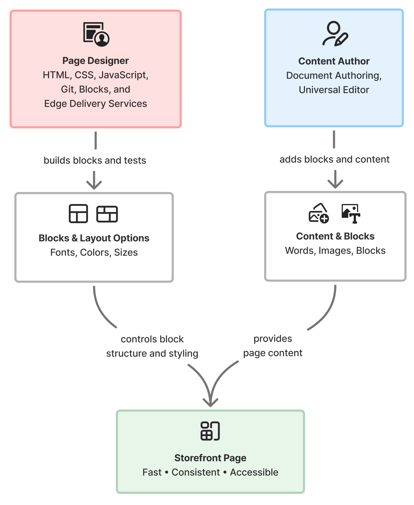

import CardGrid from '@components/CardGrid.astro';
import Card from '@components/Card.astro';
import Diagram from '@components/Diagram.astro';

A storefront page combines content, such as text and images, with presentation, such as layouts, fonts, colors, and sizes. As a content author, you manage the content in Document Authoring (DA.live) and Experience Workspace. Your page designer defines its presentation in the storefront code.

<Diagram caption="Your content combines with the presentation defined by your page designer to create a storefront page.">
  
</Diagram>

## Why this split exists

This separation lets you update page content without editing code. Reusable, tested layouts help keep pages fast, consistent, and accessible without styling each page separately. The consistent markup they produce is also easier to optimize for search engines.

## Page Designer and Content Author

Your authoring work uses the blocks and layout options that a page designer provides:

<CardGrid>
  <Card icon="pencil" title="Content Author">
    You add text, images, and pre-built blocks to a page, then choose from the available layout options. Other authoring tasks include managing block settings, placeholders, metadata, publishing, and scheduling.

    This is the author role in [Author and developer tasks](/merchants/blocks/author-and-developer-tasks/).
  </Card>
  <Card icon="puzzle" title="Page Designer">
    Page designers build and modify content blocks and Commerce blocks, including styling, spacing, and behavior across devices. A page designer can also connect an existing drop-in to a new Commerce block.

    The page designer's work requires HTML, CSS, Git, and JavaScript skills, plus knowledge of Edge Delivery Services component design. New drop-in packages or changes to a drop-in's internal behavior require a developer.

    The [Blocks Reference](/blocks/) lists existing blocks your page designer can extend. [Create commerce blocks](/blocks/create-commerce-blocks/) provides instructions for building a new one.
  </Card>
</CardGrid>

## How the roles work together

A page designer builds and tests the layout options available to you. For example, a hero banner might offer two-column and full-width layouts for you to choose from.

{/* TODO: replace with a concrete, publishable example of a variation set (for example, a hero banner). Pending: access to genericized OPTP/eLuscious walkthroughs (blocked on clearance for public use), or an example built from this boilerplate's own blocks/section metadata instead. */}

If you need a new block or layout option, work with your page designer. Changes that require a new drop-in, live catalog data beyond what an existing drop-in provides, or changes to a drop-in's internal behavior need a developer. See [Author and developer tasks](/merchants/blocks/author-and-developer-tasks/) to identify which role can help with your request.

## Templates for content pages

Templates provide a starting point for common pages, such as landing pages and category pages. When your project provides templates, choose the one closest to your needs, then replace its sample content and adjust the available settings.

## Get started

To create a page with existing blocks, follow [Create your first commerce page](/how-tos/create-commerce-page/). The exercise uses Experience Workspace's **Content** view to create a test category page.

{/* TODO: add reference implementation examples built from this boilerplate's own blocks and section metadata. Access was restricted for public use (Oleg Posyniak, Slack, 2026-08); this page stays in the Commerce storefront docs, not Adobe Experience League, per the same thread. */}
